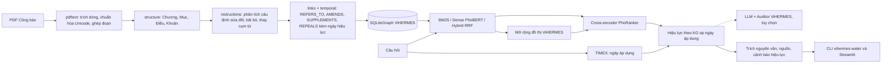

# TempLaw-KAG: hỏi đáp pháp luật tài nguyên nước có nhận thức thời gian

Đồ án kết thúc môn học Xử lý ngôn ngữ tự nhiên (P1). Hệ thống đọc các văn bản pháp luật về tài nguyên nước của Việt Nam từ **bản Công báo chính thức**, tách thành điều và khoản, rồi xây dựng **Knowledge Graph hiệu lực**. Đồ thị có quan hệ dẫn chiếu, sửa đổi, bổ sung và **bãi bỏ**, mỗi thay đổi đều gắn ngày hiệu lực. Hệ thống trả lời câu hỏi tiếng Việt bằng **đoạn trích nguyên văn** của điều khoản **đang có hiệu lực tại thời điểm được hỏi** ("hiện nay", "năm 2025", "trước khi Luật 146/2025/QH15 có hiệu lực").

Truy xuất kết hợp BM25 âm tiết + bigram, bi-encoder tiếng Việt (PhoBERT, có tách từ), RRF và cross-encoder PhoRanker. Phần lõi đồ thị và truy xuất tái sử dụng mã nguồn [ViHERMES](docs/VIHERMES_README.md) (ACIIDS 2026). README gốc của ViHERMES được giữ nguyên tại [`docs/VIHERMES_README.md`](docs/VIHERMES_README.md).

> Hệ thống chỉ trích dẫn văn bản, không đưa ra tư vấn pháp lý. Kết quả benchmark hiện là **tạm thời** vì 62 câu hỏi chưa được người dùng xác nhận (`needs_review`).

Tài liệu: [bài báo (.docx)](reports/NguyenMinhHuy_BaoCao_KnowledgeGraph.docx) · [slide (.pptx)](reports/NguyenMinhHuy_BaoCao_KnowledgeGraph_slide.pptx) · [báo cáo kỹ thuật phiên bản 2](reports/BAO_CAO_NANG_CAP.md) · [kịch bản demo](reports/KICH_BAN_DEMO.md) · [báo cáo phiên bản 1](reports/BAO_CAO_P1.md) (các tệp phiên bản 1 trong `reports/v1/`)

## Kết quả chính

| Hạng mục | Giá trị (đo trên dữ liệu thật) |
| :-- | --: |
| Văn bản | 5 |
| Contexts (điều + khoản) | 1.383 (250 điều, 1.133 khoản) |
| Nút / cạnh đồ thị | 1.412 / 2.480 |
| Dẫn chiếu / sửa đổi / bổ sung / bãi bỏ | 568 / 497 / 14 / 18 |
| Sự kiện hiệu lực có ngày | 529 (75 thay thế toàn bộ, 18 bãi bỏ toàn bộ, 69 sửa một phần, 27 bãi bỏ một phần, 14 bổ sung, 326 thay cụm từ) |
| Câu hỏi benchmark | 62 = 40 theo chủ đề + 22 theo thời điểm (đều `needs_review`) |

**Truy xuất theo chủ đề (40 câu, k = 10 hạt giống):**

| Phương pháp | Recall@5 | Recall@10 | MRR@10 | Thời gian |
| :-- | --: | --: | --: | --: |
| BM25 (âm tiết + bigram) – phiên bản 1 | 0,646 | 0,767 | 0,599 | 3 ms |
| Graph (BM25 + ViHERMES) – phiên bản 1 | 0,646 | 0,767 | 0,599 | 6 ms |
| Dense (bi-encoder tiếng Việt) | 0,842 | 0,942 | 0,779 | 11 ms |
| Hybrid (BM25 + Dense, RRF) | 0,804 | 0,892 | 0,803 | 13 ms |
| **Hybrid + Reranker** | **0,854** | **0,979** | **0,834** | 284 ms |
| Graph + Hybrid + Reranker | 0,854 | 0,967 | 0,832 | 358 ms |

**Truy xuất theo thời điểm (22 câu):**

| Hybrid + Reranker | Recall@10 | MRR@10 | Stale@5 |
| :-- | --: | --: | --: |
| không xử lý thời gian | 0,886 | 0,565 | 0,373 |
| lọc theo ngày hiệu lực văn bản | 0,886 | 0,587 | 0,209 |
| **hiệu lực theo Knowledge Graph** | **1,000** | **0,778** | **0,000** |

**Cấp câu trả lời (62 câu, đầu-cuối):** tỷ lệ câu có đoạn trích đầu tiên thuộc điều khoản đúng tăng từ 0,548 (BM25 + chọn đoạn từ vựng, phiên bản 1) lên **0,790** (Graph + Hybrid + Reranker + chọn đoạn ngữ nghĩa).

Kết luận chính:

- Truy xuất thần kinh cải thiện truy xuất theo chủ đề. BM25 → Hybrid tăng MRR@10 thêm 0,204, có ý nghĩa sau hiệu chỉnh Holm (p = 0,022).
- Mở rộng láng giềng trên đồ thị gần như không giúp ích ở bộ câu hỏi theo chủ đề.
- Giá trị thật của Knowledge Graph là **lớp hiệu lực theo thời gian**. Lớp này tăng MRR@10 thêm 0,213 (11 thắng, 0 thua, p_Holm = 0,011) và loại toàn bộ luật đã hết hiệu lực khỏi top-5.

Chi tiết, kiểm định thống kê và phân tích lỗi nằm trong [báo cáo nâng cấp](reports/BAO_CAO_NANG_CAP.md).

## Mục tiêu

1. Thu thập văn bản pháp luật chính thức về tài nguyên nước.
2. Trích xuất nội dung thành điều, khoản có mã định danh và nguồn gốc rõ ràng.
3. Xây dựng Knowledge Graph với quan hệ `HAS_ARTICLE`, `HAS_CLAUSE`, `REFERS_TO`, `AMENDS`, `SUPPLEMENTS`, `REPEALS`, trong đó mỗi thay đổi có ngày hiệu lực.
4. Trả lời câu hỏi tiếng Việt bằng trích dẫn nguyên văn, đúng phiên bản luật tại thời điểm được hỏi.
5. So sánh BM25, dense, hybrid, reranker và graph bằng Recall@k, MRR@10, Stale@5, kèm kiểm định ý nghĩa thống kê.

## Dữ liệu

| Văn bản | Phạm vi sử dụng | Nguồn |
| :-- | :-- | :-- |
| Luật Tài nguyên nước số 28/2023/QH15 | Toàn bộ 86 điều | [vanban.chinhphu.vn](https://vanban.chinhphu.vn/?pageid=27160&docid=209626) |
| Nghị định 53/2024/NĐ-CP (quy định chi tiết Luật) | 98 điều, bỏ phụ lục | [vanban.chinhphu.vn](https://vanban.chinhphu.vn/?pageid=27160&docid=210246) |
| Nghị định 54/2024/NĐ-CP (khoan nước dưới đất, cấp phép, tiền cấp quyền) | 59 điều, bỏ phụ lục | [vanban.chinhphu.vn](https://vanban.chinhphu.vn/?pageid=27160&docid=210244) |
| Nghị định 23/2026/NĐ-CP (sửa đổi NĐ 53 và NĐ 54) | 4 điều, bỏ phụ lục | [vanban.chinhphu.vn](https://vanban.chinhphu.vn/?pageid=27160&docid=216670) |
| Luật 146/2025/QH15 (sửa đổi 15 luật) | Chỉ Điều 10 (sửa Luật Tài nguyên nước), 16, 17 | [vanban.chinhphu.vn](https://vanban.chinhphu.vn/?pageid=27160&docid=216543) |

Nội dung lấy từ PDF Công báo do Văn phòng Chính phủ phát hành (có lớp văn bản). Mỗi tệp được ghi URL và mã SHA-256 trong [`data/water_resources/sources.json`](data/water_resources/sources.json). Quyết định 274/QĐ-TTg không được đưa vào vì bản chính thức là PDF scan; dự án không dùng OCR.

## Công nghệ

| Thành phần | Công nghệ |
| :-- | :-- |
| Đồ thị, BM25, lan truyền theo quan hệ | ViHERMES (`SQLiteGraph`, `HybridRetriever`, `GraphPropagator`; Conductor/Auditor cho LLM) |
| Tách từ tiếng Việt | pyvi (CRF) |
| Bi-encoder | `bkai-foundation-models/vietnamese-bi-encoder` (PhoBERT); đối chứng `intfloat/multilingual-e5-small` |
| Cross-encoder | `itdainb/PhoRanker` (PhoBERT) |
| Mô hình học sâu | PyTorch, sentence-transformers (CPU hoặc Apple MPS) |
| Lưu trữ | SQLite (một tệp, không cần máy chủ) |
| Đọc PDF | PyMuPDF |
| Giao diện | Streamlit (đồ thị vẽ bằng Graphviz) |
| Biểu đồ, kiểm thử | Matplotlib; pytest, ruff |

Không cần GPU, không cần API trả phí. Phần sinh câu trả lời bằng LLM là tùy chọn.

## Kiến trúc



| Mô-đun | Vai trò |
| :-- | :-- |
| [`sources.py`](src/vihermes/water/sources.py) | Đọc danh mục nguồn, tải tệp và kiểm tra SHA-256 |
| [`pdftext.py`](src/vihermes/water/pdftext.py) | Trích văn bản PDF, bỏ phần trang trí, chuẩn hóa tiếng Việt, ghép dòng thành đoạn |
| [`structure.py`](src/vihermes/water/structure.py) | Tách Chương, Mục, Điều, Khoản; bỏ qua phần trích dẫn trong văn bản sửa đổi |
| [`instructions.py`](src/vihermes/water/instructions.py) | Phân tích câu lệnh sửa đổi: danh sách dẫn chiếu tiếng Việt, loại thao tác, phạm vi |
| [`links.py`](src/vihermes/water/links.py) | Dẫn chiếu và quan hệ hiệu lực giữa các điều khoản |
| [`temporal.py`](src/vihermes/water/temporal.py) | Trạng thái hiệu lực tại một ngày, phân giải theo thời điểm, nhận diện biểu thức thời gian |
| [`corpus.py`](src/vihermes/water/corpus.py) | Ghi dữ liệu đã xử lý, nạp đồ thị, gắn ngày hiệu lực, thống kê |
| [`lexical.py`](src/vihermes/water/lexical.py) | BM25 trên âm tiết và cặp âm tiết liền kề |
| [`dense.py`](src/vihermes/water/dense.py) | Tách từ, chia đoạn, bi-encoder MaxP, RRF, cross-encoder |
| [`qa.py`](src/vihermes/water/qa.py) | Pipeline truy xuất và soạn câu trả lời trích dẫn (từ vựng hoặc ngữ nghĩa) |
| [`generate.py`](src/vihermes/water/generate.py) | Tùy chọn: LLM sinh câu trả lời có trích dẫn, Auditor ViHERMES kiểm chứng |
| [`benchmark.py`](src/vihermes/water/benchmark.py) | Đánh giá truy xuất, theo thời điểm, cấp câu trả lời; kiểm định hoán vị, bootstrap |
| [`cli.py`](src/vihermes/water/cli.py) | Lệnh `vihermes-water` |
| [`app/streamlit_app.py`](app/streamlit_app.py) | Giao diện 3 trang: Hỏi đáp, Knowledge Graph, Đánh giá |

Phần mở rộng nằm trong gói con `vihermes.water`. Thay đổi duy nhất ở lõi ViHERMES là thêm quan hệ `REPEALS` vào tập quan hệ hiệu lực (`src/vihermes/models.py`).

## Cấu trúc thư mục

```text
ViHERMES/
├── app/streamlit_app.py           Giao diện demo
├── data/water_resources/
│   ├── sources.json               Danh mục văn bản, URL, SHA-256, ngày hiệu lực
│   ├── raw/<văn bản>/*.pdf        PDF Công báo gốc
│   ├── processed/<văn bản>.json   Điều, khoản đã tách
│   ├── contexts.csv               1.383 contexts (điều và khoản)
│   └── benchmark.jsonl            62 câu hỏi đánh giá (needs_review)
├── outputs/water_resources/       Sinh ra khi chạy, không đưa vào Git
│   ├── water_graph.db             Knowledge Graph (SQLite)
│   ├── dense_*.npz                Embedding đoạn văn (cache)
│   ├── graph_stats.json, evaluation.{csv,json}, evaluation_chart.png, temporal_chart.png
├── src/vihermes/                  ViHERMES gốc
│   └── water/                     Phần mở rộng của đồ án
├── tests/test_water.py, tests/test_water_upgrade.py
├── reports/BAO_CAO_NANG_CAP.md    Báo cáo phiên bản 2
└── docs/                          REVIEW_CHECKLIST.md, IMPLEMENTATION_STATUS.md, tài liệu ViHERMES
```

## Cài đặt

Dùng Python 3.10 trở lên (đã kiểm thử với Python 3.14). Chạy mọi lệnh từ thư mục gốc repository.

```bash
python -m venv .venv
source .venv/bin/activate
pip install -e '.[water,neural]'
```

Nhóm `neural` cài PyTorch, sentence-transformers và pyvi (khoảng 1 GB). Ba mô hình (khoảng 1,5 GB) được tải về cache HuggingFace ở lần dùng đầu tiên. Không cài `neural` thì chỉ dùng được `bm25` và `graph`. Để chạy toàn bộ kiểm thử, cài thêm `dev` và `dataset`.

## Chuẩn bị dữ liệu

PDF nguồn đã có sẵn trong `data/water_resources/raw/`. Lệnh sau tải lại các tệp còn thiếu từ nguồn chính thức và kiểm tra SHA-256:

```bash
vihermes-water download
```

Trích văn bản, tách điều và khoản, ghi `processed/` và `contexts.csv`:

```bash
vihermes-water process
```

Kết quả in ra số điều, khoản và cảnh báo của từng văn bản. Hai cảnh báo của Nghị định 23/2026 là lỗi ngoặc kép có sẵn trong văn bản Công báo; bộ tách đã xử lý đúng (xem báo cáo phiên bản 1, mục 3.3).

## Xây dựng Knowledge Graph

```bash
vihermes-water build-graph
vihermes-water stats --output outputs/water_resources/graph_stats.json
```

Đồ thị được ghi vào cơ sở dữ liệu riêng `outputs/water_resources/water_graph.db`. Khi tệp đã tồn tại, thêm `--force` để dựng lại. Lệnh từ chối ghi đè cơ sở dữ liệu không phải do nó tạo ra, chẳng hạn `outputs/vihermes.db`.

## Truy vấn

```bash
vihermes-water ask "Hiện nay, giấy phép khai thác nước dưới đất có thời hạn tối đa bao nhiêu năm?" --method graph_hybrid_rerank
vihermes-water ask "Ai cấp giấy phép khai thác tài nguyên nước cho công trình quy mô lớn?" --as-of 2025-06-01
vihermes-water ask "…" --llm gpt-4o-mini     # tùy chọn: OPENAI_API_KEY hoặc OPENAI_BASE_URL (Ollama, LM Studio)
```

| Phương pháp (`--method`) | Mô tả |
| :-- | :-- |
| `bm25` | BM25 âm tiết + bigram |
| `dense` | Bi-encoder tiếng Việt (tách từ pyvi, MaxP trên đoạn ≤ 150 âm tiết) |
| `hybrid` | RRF của BM25 và dense |
| `hybrid_rerank` | 30 ứng viên hybrid, xếp hạng lại bằng PhoRanker |
| `graph` | BM25 + lan truyền ViHERMES (phiên bản 1) |
| `graph_hybrid` | Hybrid + lan truyền ViHERMES |
| `graph_hybrid_rerank` | 30 ứng viên hybrid cộng láng giềng trên đồ thị, xếp hạng lại (mặc định trong giao diện) |

Thời điểm áp dụng lấy từ cụm từ thời gian trong câu hỏi; nếu không có thì lấy từ `--as-of`; nếu không có cả hai thì không xét hiệu lực. `--temporal` chọn `kg` (mặc định khi có thời điểm), `filter` (chỉ lọc theo ngày văn bản) hoặc `none`.

Kết quả là JSON gồm `answer`, `answer_type`, `quotes`, `sources`, `evidence` (mỗi bằng chứng có trạng thái hiệu lực `validity`), `amendments`, `as_of`, `time_expression`, `warnings` và `elapsed_ms`.

| `answer_type` | Ý nghĩa |
| :-- | :-- |
| `extractive` | Đoạn trích nguyên văn kèm điều, khoản |
| `reference_only` | Không đoạn nào đủ liên quan (từ vựng: độ phủ < 35%; ngữ nghĩa: xác suất cross-encoder < 0,5); chỉ liệt kê điều khoản tham khảo |
| `not_found` | Không có điều khoản nào khớp |
| `empty_question` | Câu hỏi rỗng |

## Giao diện

```bash
streamlit run app/streamlit_app.py
```

Mở `http://localhost:8501`. Giao diện có ba trang:

- **Hỏi đáp**: chọn phương pháp và **thời điểm áp dụng** (mặc định hôm nay; cụm từ thời gian trong câu hỏi được ưu tiên). Mỗi bằng chứng có nhãn hiệu lực ("đang có hiệu lực", "đã bị bãi bỏ", …); quan hệ đồ thị đã dùng được vẽ bằng Graphviz; ô "So sánh với BM25" hiển thị hai danh sách cạnh nhau.
- **Knowledge Graph**: số nút, cạnh, loại quan hệ (kể cả bãi bỏ), đồ thị giữa các văn bản và đồ thị lân cận của từng điều.
- **Đánh giá**: bảng kết quả, kiểm định thống kê, kết quả theo nhóm, bộ câu hỏi theo thời điểm và chi tiết từng câu.

## Benchmark

```bash
vihermes-water evaluate             # truy xuất: 11 cấu hình chủ đề + 10 cấu hình thời điểm (15–25 phút)
vihermes-water evaluate-answers     # cấp câu trả lời, ghi thêm vào evaluation.json
vihermes-water evaluate --no-neural # chỉ BM25 và Graph, không cần PyTorch
```

`data/water_resources/benchmark.jsonl` có 62 câu: `direct` 10, `multi_provision` 10, `cross_document` 9, `colloquial` 11 (diễn đạt đời thường) và `temporal` 22 (mỗi câu có `as_of`; đáp án là điều khoản có hiệu lực tại ngày đó). Mỗi câu có `verification_status`; người review đổi thành `verified` sau khi kiểm tra, và báo cáo tách riêng kết quả trên các câu đã xác nhận.

## Kiểm thử

```bash
pytest -q
ruff check src tests app
```

`tests/test_water.py` kiểm tra pipeline của phiên bản 1. `tests/test_water_upgrade.py` kiểm tra: phân tích câu lệnh sửa đổi, cạnh bãi bỏ và sự kiện có ngày, trạng thái hiệu lực, phân giải theo thời điểm, nhận diện biểu thức thời gian, câu trả lời theo thời điểm, RRF, kiểm định thống kê và sinh câu trả lời bằng LLM (dùng mô hình giả lập). Ba kiểm thử adapter (OpenAI, Milvus, Neo4j) bị bỏ qua khi thiếu dịch vụ.

## Biến môi trường

| Biến | Mặc định | Dùng cho |
| :-- | :-- | :-- |
| `WATER_QA_DATA` | `data/water_resources` | Thư mục dữ liệu |
| `WATER_QA_OUTPUT` | `outputs/water_resources` | Thư mục kết quả |
| `WATER_QA_DB` | `$WATER_QA_OUTPUT/water_graph.db` | Cơ sở dữ liệu đồ thị |

Các lệnh cũng nhận đường dẫn qua tham số `--db`, `--raw`, `--output`, `--benchmark`.

## Hạn chế

- Benchmark nhỏ (62 câu), do cùng một người soạn và chưa được xác nhận; nhóm câu đời thường và theo thời điểm được soạn khi đã biết hệ thống.
- Ngày hiệu lực ở cấp văn bản; ngoại lệ trong văn bản (ví dụ khoản 2 Điều 16 Luật 146/2025/QH15) chưa được mô hình hóa.
- Không có Luật 17/2012/QH13, nên câu hỏi về thời điểm trước 01/07/2024 chỉ nhận cảnh báo.
- Văn bản gốc và văn bản sửa đổi được lưu riêng; hệ thống chỉ ra phiên bản đang có hiệu lực nhưng không tạo văn bản hợp nhất.
- Câu trả lời là đoạn trích. Phần LLM là tùy chọn và chưa được đánh giá với mô hình thật.
- Không xử lý phụ lục (mẫu đơn, bảng hệ số) và văn bản scan.

## Giấy phép và trích dẫn

Mã nguồn theo giấy phép MIT của ViHERMES. Văn bản pháp luật là văn bản quy phạm pháp luật công khai. PyMuPDF dùng giấy phép AGPL-3.0, phù hợp với mục đích học tập. Khi sử dụng ViHERMES, hãy trích dẫn bài báo gốc theo [`CITATION.cff`](CITATION.cff).
