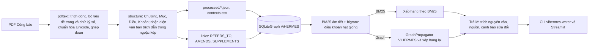

# Hỏi đáp pháp luật tài nguyên nước dựa trên Knowledge Graph và ViHERMES

Đồ án kết thúc môn học (P1). Hệ thống đọc các văn bản pháp luật về tài nguyên nước của Việt Nam từ **bản Công báo chính thức**, tách thành điều và khoản, xây dựng **Knowledge Graph** với quan hệ cấu trúc, dẫn chiếu và sửa đổi, rồi trả lời câu hỏi tiếng Việt bằng **đoạn trích nguyên văn** kèm nguồn. Hai phương pháp truy xuất, **BM25** và **Graph-based Retrieval**, được so sánh trên một benchmark nhỏ.

Phần lõi đồ thị và truy xuất tái sử dụng mã nguồn [ViHERMES](docs/VIHERMES_README.md) (ACIIDS 2026). README gốc của ViHERMES được giữ nguyên tại [`docs/VIHERMES_README.md`](docs/VIHERMES_README.md).

> Hệ thống chỉ trích dẫn văn bản, không đưa ra tư vấn pháp lý. Kết quả benchmark hiện là **tạm thời** vì bộ câu hỏi chưa được người dùng xác nhận.

## Kết quả chính

| Hạng mục | Giá trị (đo trên dữ liệu thật) |
| :-- | --: |
| Văn bản | 5 |
| Contexts (điều + khoản) | 1.383 (250 điều, 1.133 khoản) |
| Nút / cạnh đồ thị | 1.412 / 2.492 |
| Quan hệ dẫn chiếu / sửa đổi / bổ sung | 597 / 503 / 9 |
| Dẫn chiếu chưa giải quyết | 27 cạnh tới 24 nút giữ chỗ |
| Câu hỏi benchmark | 29 (đều ở trạng thái `needs_review`) |

| Phương pháp (k = 10 điều khoản hạt giống) | Recall@5 | Recall@10 | MRR@10 | Thời gian |
| :-- | --: | --: | --: | --: |
| BM25 (âm tiết + bigram) | 0,684 | 0,816 | 0,658 | 4,1 ms |
| Graph-based (ViHERMES + xếp hạng lại) | 0,684 | 0,816 | 0,658 | 8,3 ms |

Trên benchmark nhỏ này, Graph không làm thay đổi Recall/MRR. Graph bổ sung văn bản sửa đổi vào kết quả (độ phủ sửa đổi@10 tăng từ 0,200 lên 0,293) và cảnh báo khi điều khoản được trích đã bị sửa đổi. Phân tích chi tiết nằm trong [báo cáo](reports/BAO_CAO_P1.md).

## Mục tiêu

1. Thu thập văn bản pháp luật chính thức về tài nguyên nước.
2. Trích xuất nội dung thành điều, khoản có mã định danh và nguồn gốc rõ ràng.
3. Xây dựng Knowledge Graph với quan hệ `HAS_ARTICLE`, `HAS_CLAUSE`, `REFERS_TO`, `AMENDS`, `SUPPLEMENTS`.
4. Trả lời câu hỏi tiếng Việt bằng trích dẫn nguyên văn kèm nguồn.
5. So sánh BM25 và Graph-based Retrieval bằng Recall@5, Recall@10, MRR@10 và thời gian truy xuất.

## Dữ liệu

| Văn bản | Phạm vi sử dụng | Nguồn |
| :-- | :-- | :-- |
| Luật Tài nguyên nước số 28/2023/QH15 | Toàn bộ 86 điều | [vanban.chinhphu.vn](https://vanban.chinhphu.vn/?pageid=27160&docid=209626) |
| Nghị định 53/2024/NĐ-CP (quy định chi tiết Luật) | 98 điều, bỏ phụ lục | [vanban.chinhphu.vn](https://vanban.chinhphu.vn/?pageid=27160&docid=210246) |
| Nghị định 54/2024/NĐ-CP (khoan nước dưới đất, cấp phép, tiền cấp quyền) | 59 điều, bỏ phụ lục | [vanban.chinhphu.vn](https://vanban.chinhphu.vn/?pageid=27160&docid=210244) |
| Nghị định 23/2026/NĐ-CP (sửa đổi NĐ 53 và NĐ 54) | 4 điều, bỏ phụ lục | [vanban.chinhphu.vn](https://vanban.chinhphu.vn/?pageid=27160&docid=216670) |
| Luật 146/2025/QH15 (sửa đổi 15 luật) | Chỉ Điều 10 (sửa Luật Tài nguyên nước), 16, 17 | [vanban.chinhphu.vn](https://vanban.chinhphu.vn/?pageid=27160&docid=216543) |

Nội dung lấy từ PDF Công báo do Văn phòng Chính phủ phát hành (có lớp văn bản). Mỗi tệp được ghi URL và mã SHA-256 trong [`data/water_resources/sources.json`](data/water_resources/sources.json). Quyết định 274/QĐ-TTg không được đưa vào vì bản chính thức là PDF scan; dự án không dùng OCR.

## Công nghệ

| Thành phần | Công nghệ |
| :-- | :-- |
| Đồ thị, BM25, lan truyền theo quan hệ | ViHERMES (`SQLiteGraph`, `HybridRetriever`, `GraphPropagator`, `Pathfinder`) |
| Lưu trữ | SQLite (một tệp, không cần máy chủ) |
| Đọc PDF | PyMuPDF |
| Giao diện | Streamlit (đồ thị vẽ bằng Graphviz phía trình duyệt) |
| Biểu đồ đánh giá | Matplotlib |
| Kiểm thử | pytest, ruff |

Không cần GPU, không cần API trả phí, không cần mô hình ngôn ngữ.

## Kiến trúc



| Mô-đun | Vai trò |
| :-- | :-- |
| [`sources.py`](src/vihermes/water/sources.py) | Đọc danh mục nguồn, tải tệp và kiểm tra SHA-256 |
| [`pdftext.py`](src/vihermes/water/pdftext.py) | Trích văn bản PDF, bỏ phần trang trí, chuẩn hóa tiếng Việt, ghép dòng thành đoạn theo thụt lề |
| [`structure.py`](src/vihermes/water/structure.py) | Tách Chương, Mục, Điều, Khoản; bỏ qua phần trích dẫn trong văn bản sửa đổi |
| [`links.py`](src/vihermes/water/links.py) | Phát hiện dẫn chiếu và quan hệ sửa đổi giữa các điều khoản |
| [`corpus.py`](src/vihermes/water/corpus.py) | Ghi dữ liệu đã xử lý, nạp đồ thị, thống kê |
| [`lexical.py`](src/vihermes/water/lexical.py) | BM25 trên âm tiết và cặp âm tiết liền kề |
| [`qa.py`](src/vihermes/water/qa.py) | Truy xuất BM25 / Graph và soạn câu trả lời trích dẫn |
| [`benchmark.py`](src/vihermes/water/benchmark.py) | Đánh giá Recall, MRR, thời gian; xuất CSV, JSON, biểu đồ |
| [`cli.py`](src/vihermes/water/cli.py) | Lệnh `vihermes-water` |
| [`app/streamlit_app.py`](app/streamlit_app.py) | Giao diện 3 trang: Hỏi đáp, Knowledge Graph, Đánh giá |

Mã nguồn gốc của ViHERMES không bị thay đổi; phần mở rộng nằm trong gói con `vihermes.water`.

## Cấu trúc thư mục

```text
ViHERMES/
├── app/streamlit_app.py           Giao diện demo
├── data/water_resources/
│   ├── sources.json               Danh mục văn bản, URL, SHA-256
│   ├── raw/<văn bản>/*.pdf        PDF Công báo gốc
│   ├── processed/<văn bản>.json   Điều, khoản đã tách
│   ├── processed/<văn bản>.txt    Văn bản sạch để đối chiếu
│   ├── contexts.csv               1.383 contexts (điều và khoản)
│   └── benchmark.jsonl            29 câu hỏi đánh giá (needs_review)
├── outputs/water_resources/       Sinh ra khi chạy, không đưa vào Git
│   ├── water_graph.db             Knowledge Graph (SQLite)
│   ├── graph_stats.json
│   ├── evaluation.csv / evaluation.json / evaluation_chart.png
├── src/vihermes/                  ViHERMES gốc
│   └── water/                     Phần mở rộng của đồ án
├── tests/test_water.py            Kiểm thử của đồ án
├── reports/BAO_CAO_P1.md          Báo cáo môn học
└── docs/                          REVIEW_CHECKLIST.md, IMPLEMENTATION_STATUS.md, tài liệu ViHERMES
```

## Cài đặt

Dùng Python 3.10 trở lên (đã kiểm thử với Python 3.14). Chạy mọi lệnh từ thư mục gốc repository.

```bash
python -m venv .venv
source .venv/bin/activate
pip install -e '.[water]'
```

Để chạy toàn bộ kiểm thử, kể cả kiểm thử gốc của ViHERMES, cài thêm `dev` và `dataset`: `pip install -e '.[water,dev,dataset]'`.

## Chuẩn bị dữ liệu

PDF nguồn đã có sẵn trong `data/water_resources/raw/`. Lệnh sau tải lại các tệp còn thiếu từ nguồn chính thức và kiểm tra SHA-256:

```bash
vihermes-water download
```

Trích văn bản, tách điều và khoản, ghi `processed/` và `contexts.csv`:

```bash
vihermes-water process
```

Kết quả in ra số điều, khoản và cảnh báo của từng văn bản. Hai cảnh báo của Nghị định 23/2026 là lỗi ngoặc kép có sẵn trong văn bản Công báo; bộ tách đã xử lý đúng (xem báo cáo, mục 3.3).

## Xây dựng Knowledge Graph

```bash
vihermes-water build-graph
vihermes-water stats --output outputs/water_resources/graph_stats.json
```

Đồ thị được ghi vào cơ sở dữ liệu riêng `outputs/water_resources/water_graph.db`. Khi tệp đã tồn tại, thêm `--force` để dựng lại. Lệnh từ chối ghi đè cơ sở dữ liệu không phải do nó tạo ra, chẳng hạn `outputs/vihermes.db`.

## Truy vấn

```bash
vihermes-water ask "Giấy phép khai thác nước dưới đất có thời hạn tối đa bao nhiêu năm?"
vihermes-water ask --method bm25 "Mức thu tiền cấp quyền khai thác tài nguyên nước (M) có giá trị trong khoảng bao nhiêu?"
```

Kết quả là JSON gồm `answer`, `answer_type`, `quotes`, `sources`, `evidence`, `amendments`, `warnings` và `elapsed_ms`. Thêm `--full` để in toàn văn bằng chứng và các cạnh đồ thị; `-k` đặt số điều khoản hạt giống (mặc định 5).

`answer_type` có bốn giá trị:

| Giá trị | Ý nghĩa |
| :-- | :-- |
| `extractive` | Câu trả lời gồm các đoạn trích nguyên văn từ văn bản, kèm điều, khoản |
| `reference_only` | Bằng chứng chưa bao phủ đủ từ khóa (dưới 35%); chỉ liệt kê điều khoản tham khảo |
| `not_found` | Không có điều khoản nào khớp |
| `empty_question` | Câu hỏi rỗng |

## Giao diện

```bash
streamlit run app/streamlit_app.py
```

Mở `http://localhost:8501`. Giao diện có ba trang:

- **Hỏi đáp**: nhập câu hỏi, chọn BM25 hoặc Graph, xem câu trả lời, nguồn văn bản, bằng chứng, thời gian truy xuất và các quan hệ đồ thị đã dùng. Ô "So sánh hai phương pháp" hiển thị hai danh sách kết quả cạnh nhau.
- **Knowledge Graph**: số nút, cạnh, loại quan hệ, đồ thị giữa các văn bản và đồ thị lân cận của từng điều.
- **Đánh giá**: bảng kết quả, biểu đồ, kết quả theo nhóm câu hỏi và chi tiết từng câu.

Liên kết dạng `http://localhost:8501/?q=<câu hỏi>&method=bm25&compare=1` mở sẵn một câu hỏi.

## Benchmark

```bash
vihermes-water evaluate
```

Lệnh đánh giá 29 câu hỏi trong `data/water_resources/benchmark.jsonl` với 4 cấu hình: BM25, Graph, Graph theo thứ tự gốc của ViHERMES và BM25 chỉ dùng âm tiết. Kết quả được ghi vào `outputs/water_resources/evaluation.{csv,json}` và `evaluation_chart.png`.

Mỗi câu hỏi có `verification_status`. Khi người review đã kiểm tra câu hỏi, các điều khoản kỳ vọng và đáp án tham chiếu, họ đổi giá trị thành `verified`. Báo cáo đánh giá tách riêng kết quả trên các câu đã xác nhận.

## Kiểm thử

```bash
pytest -q
ruff check src tests app
```

`tests/test_water.py` kiểm tra việc đọc PDF thật, chuẩn hóa tiếng Việt, tách điều và khoản, tính duy nhất của contexts, dựng đồ thị, truy vấn BM25 và Graph, nguồn trích dẫn, câu hỏi rỗng, câu hỏi không có kết quả và khả năng khởi chạy giao diện. Các kiểm thử gốc của ViHERMES vẫn chạy. Ba kiểm thử adapter (OpenAI, Milvus, Neo4j) bị bỏ qua khi thiếu dịch vụ tương ứng.

## Biến môi trường

| Biến | Mặc định | Dùng cho |
| :-- | :-- | :-- |
| `WATER_QA_DATA` | `data/water_resources` | Thư mục dữ liệu |
| `WATER_QA_OUTPUT` | `outputs/water_resources` | Thư mục kết quả |
| `WATER_QA_DB` | `$WATER_QA_OUTPUT/water_graph.db` | Cơ sở dữ liệu đồ thị |

Các lệnh cũng nhận đường dẫn qua tham số `--db`, `--raw`, `--output`, `--benchmark`.

## Hạn chế

- Truy xuất hoàn toàn dựa trên từ vựng; câu hỏi diễn đạt khác văn bản ("điều chỉnh những vấn đề gì" so với "Phạm vi điều chỉnh") có thể không tìm đúng điều.
- Câu trả lời là đoạn trích. Hệ thống không tổng hợp và không suy luận pháp lý, nên người dùng cần đọc bằng chứng đi kèm.
- Văn bản gốc và văn bản sửa đổi được lưu riêng, hệ thống không tạo văn bản hợp nhất. Graph chỉ chỉ ra điều khoản nào đã bị sửa.
- Không xử lý phụ lục (mẫu đơn, bảng hệ số) và văn bản scan.
- Benchmark nhỏ và do cùng một người soạn, chưa được xác nhận.

## Giấy phép và trích dẫn

Mã nguồn theo giấy phép MIT của ViHERMES. Văn bản pháp luật là văn bản quy phạm pháp luật công khai. PyMuPDF dùng giấy phép AGPL-3.0, phù hợp với mục đích học tập. Khi sử dụng ViHERMES, hãy trích dẫn bài báo gốc theo [`CITATION.cff`](CITATION.cff).
