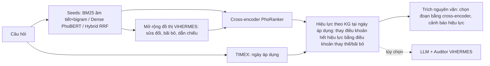
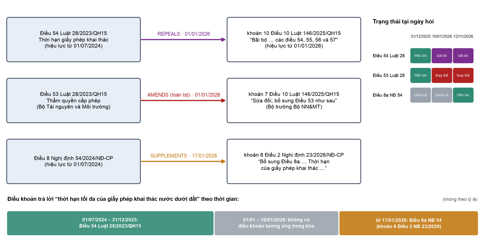
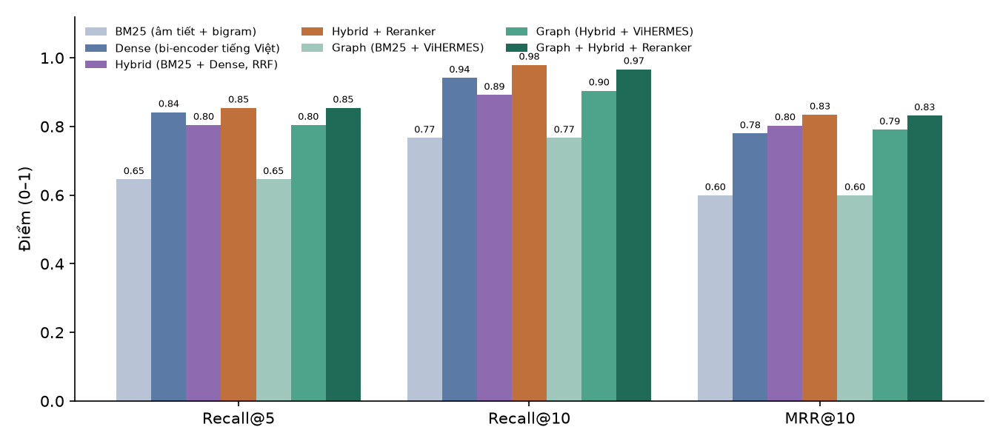
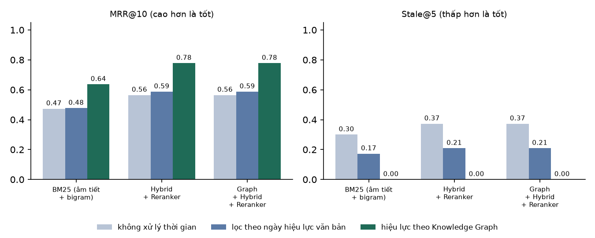

# BÁO CÁO NÂNG CẤP: TempLaw-KAG CHO PHÁP LUẬT TÀI NGUYÊN NƯỚC

**Hỏi đáp pháp luật tiếng Việt có nhận thức thời gian, kết hợp truy xuất thần kinh và Knowledge Graph hiệu lực**

> Tài liệu này mô tả phiên bản 2 của đồ án P1 (cập nhật 12/11/2026). Phiên bản 1 được mô tả trong [`BAO_CAO_P1.md`](BAO_CAO_P1.md). Mọi số liệu dưới đây được đo trực tiếp bằng các lệnh ở Phụ lục A, trên máy Apple M4 Pro (PyTorch, thiết bị MPS). Toàn bộ 62 câu hỏi đánh giá **chưa được xác nhận độc lập** (`needs_review`), nên kết quả là **tạm thời**.

## 1. Vấn đề của phiên bản 1 và mục tiêu nâng cấp

Phiên bản 1 xây dựng Knowledge Graph từ 5 văn bản Công báo, truy xuất bằng BM25 và lan truyền đồ thị ViHERMES. Phiên bản này có bốn hạn chế chính:

1. **Không có thành phần NLP học máy.** Toàn bộ hệ thống chạy bằng luật và BM25 trên âm tiết. Không có tách từ, embedding hay mô hình xếp hạng. Câu hỏi dùng từ đời thường ("nước ngầm", "khai báo") không khớp thuật ngữ trong luật ("nước dưới đất", "kê khai").
2. **Kết quả chính bằng không.** Graph và BM25 cho Recall@10 và MRR@10 giống hệt nhau (0,816 và 0,658).
3. **Chưa xử lý thời gian, dù đề tài là TempLaw-KAG.** Hệ thống không trả lời được "tại ngày X, quy định nào đang có hiệu lực", và bộ phân tích bỏ sót câu lệnh bãi bỏ "các điều 54, 55, 56 và 57". Hệ quả là Điều 54 Luật 28/2023 (đã bị bãi bỏ từ 01/01/2026) vẫn được trích như luật hiện hành.
4. **Có 2 cạnh `AMENDS` sai.** Nguyên nhân là Công báo đóng ngoặc kép ngay sau tiêu đề "“Điều 33. …”", nên thân điều bị đọc nhầm thành câu lệnh.

Phiên bản 2 giải quyết bốn điểm trên bằng năm thành phần mới (Hình 1):

| # | Thành phần | Kỹ thuật NLP |
| :-- | :-- | :-- |
| 1 | Bộ phân tích câu lệnh sửa đổi | Phân tích cú pháp dựa trên luật cho danh sách dẫn chiếu tiếng Việt ("điểm c khoản 1, các khoản 3, 4 và 5 Điều 19"); phân loại thao tác bãi bỏ, thay thế, sửa một phần, thay cụm từ |
| 2 | Knowledge Graph hiệu lực theo thời gian | Mỗi điều/khoản có `valid_from` và các sự kiện thay đổi có ngày; truy vấn trạng thái tại một ngày |
| 3 | Nhận diện và chuẩn hóa biểu thức thời gian | Nhận diện thực thể thời gian (TIMEX) tiếng Việt: "hiện nay", "năm 2025", "ngày 15/3/2026", "trước khi Luật 146/2025/QH15 có hiệu lực" |
| 4 | Truy xuất thần kinh | Tách từ (pyvi), bi-encoder tiếng Việt (PhoBERT), kết hợp lai BM25 + dense bằng RRF, cross-encoder xếp hạng lại |
| 5 | Chọn đoạn trích ngữ nghĩa và sinh câu trả lời | Cross-encoder chọn đoạn trích nguyên văn; tùy chọn LLM sinh câu trả lời có trích dẫn, được kiểm chứng bởi Auditor của ViHERMES |



_Hình 1. Pipeline TempLaw-KAG. Các nét đứt là thành phần tùy chọn._

## 2. Phương pháp

### 2.1. Phân tích câu lệnh sửa đổi (`instructions.py`)

Một khoản của văn bản sửa đổi trộn hai loại nội dung: **câu lệnh** ("7. Sửa đổi, bổ sung Điều 53 như sau:", "a) Bãi bỏ khoản 4 Điều 9; …; các điều 54, 55, 56 và 57;") và **văn bản thay thế** (trong ngoặc kép). Bộ phân tích mới hoạt động như sau:

- **Chỉ đọc dòng câu lệnh**: dòng đầu của khoản, và các mục con "a) … b) …" nằm ngoài ngoặc kép. Mọi đoạn khác được coi là văn bản thay thế, kể cả khi Công báo đóng ngoặc sớm. Điều này loại được 2 cạnh sai đã biết.
- **Phân tích danh sách dẫn chiếu theo trật tự tiếng Việt.** Tiếng Việt nêu đơn vị nhỏ trước ("điểm c khoản 1 Điều 19"), nên điểm chờ khoản và khoản chờ điều. Bộ phân tích xử lý được danh sách số nhiều ("các điều 54, 55, 56 và 57", "các khoản 3, 4 và 5"), danh sách hỗn hợp ("khoản 1 và điểm e khoản 3 Điều 9"), và ngữ cảnh kế thừa từ dòng tiêu đề ("Sửa đổi, bổ sung một số khoản của Điều 17 như sau: a) Sửa đổi khoản 1 …").
- **Phân loại thao tác và phạm vi:**

| Thao tác | Ví dụ | Quan hệ | Phạm vi |
| :-- | :-- | :-- | :-- |
| `repeal` | "Bãi bỏ Điều 16" | `REPEALS` (mới) | toàn bộ, hoặc một phần nếu chỉ bãi bỏ điểm |
| `amend` | "Sửa đổi, bổ sung Điều 53 như sau" | `AMENDS` | toàn bộ (thay thế), hoặc một phần |
| `supplement` | "Bổ sung Điều 8a vào sau Điều 8" | `SUPPLEMENTS` | neo vào điều/khoản đứng trước |
| `wording` | "Thay thế cụm từ “42 ngày” bằng “30 ngày làm việc” tại khoản 1 Điều 28" | `AMENDS` | một phần (thay cụm từ) |

Quan hệ `REPEALS` được thêm vào tập quan hệ hiệu lực của ViHERMES. Đây là **thay đổi duy nhất trong mã lõi ViHERMES** (một dòng trong `models.py`): điều khoản bị bãi bỏ không có văn bản kế thừa, nên không được trình bày như "được sửa đổi".

**So sánh với phiên bản 1** (đối chiếu từng cạnh giữa đồ thị cũ dựng lại từ commit trước và đồ thị mới):

| | Phiên bản 1 | Phiên bản 2 |
| :-- | --: | --: |
| Cặp (điều khoản bị tác động → khoản sửa đổi) | 512 | 528 |
| Cạnh `REPEALS` | 0 | 18 |
| Cạnh `AMENDS` / `SUPPLEMENTS` | 503 / 9 | 497 / 14 |
| Cạnh `REFERS_TO` | 597 | 568 |
| Tổng số cạnh | 2.492 | 2.480 |

Phiên bản 2 loại bỏ 3 cặp sai: hai cạnh lỗi ngoặc kép (54/2024 Điều 30 và khoản 1 → 23/2026 khoản 23 Điều 2), và một cạnh nhầm "khoản 6 Điều 38" (văn bản chỉ chèn khoản 7 vào sau khoản 6). Đồng thời phiên bản 2 bổ sung 19 cặp còn thiếu, ví dụ Điều 54–57 Luật 28 bị bãi bỏ, hay "khoản 1 và điểm e khoản 3 Điều 9". Cả 22 thay đổi đã được đối chiếu thủ công với câu chữ Công báo. Số `REFERS_TO` giảm 29, gồm hai thay đổi. Thứ nhất, 30 cạnh bị bỏ: cả 30 đều trùng một cạnh hiệu lực sẵn có, do tiêu đề của văn bản thay thế ("“Điều 50. …") trỏ về chính điều đang bị sửa. Thứ hai, 1 cạnh được thêm: 23/2026 khoản 23 Điều 2 → 54/2024 khoản 1 Điều 30, lấy từ phần thân trước đây bị đọc nhầm thành câu lệnh. Sự kiện thay đổi theo loại và phạm vi: thay thế toàn bộ 75, sửa một phần 69, bãi bỏ toàn bộ 18, bãi bỏ một phần 27, bổ sung 14, thay cụm từ 326.

### 2.2. Knowledge Graph hiệu lực theo thời gian (`temporal.py`)

Khi dựng đồ thị, mỗi sự kiện thay đổi được gắn ngày hiệu lực của văn bản sửa đổi và lưu trên nút bị tác động (`metadata.changes`). Mỗi nút còn có `valid_from` là ngày hiệu lực của văn bản chứa nó. Trạng thái của một điều/khoản tại ngày *d* được tính như sau:

| Trạng thái | Điều kiện |
| :-- | :-- |
| `not_yet` (chưa có hiệu lực) | `valid_from` > *d* |
| `repealed` (đã bị bãi bỏ) | sự kiện toàn bộ gần nhất có ngày ≤ *d* là bãi bỏ |
| `replaced` (đã được thay thế) | sự kiện toàn bộ gần nhất có ngày ≤ *d* là sửa đổi |
| `amended` (sửa đổi một phần) | chỉ có sự kiện một phần có ngày ≤ *d* |
| `in_force` (đang có hiệu lực) | các trường hợp còn lại |

Sự kiện toàn bộ ở cấp điều được áp xuống mọi khoản của điều đó.

**Phân giải theo thời điểm** (`resolve`) sắp xếp lại danh sách kết quả cho ngày *d*:

- điều khoản bị thay thế hoặc bãi bỏ được **thay tại chỗ** bằng khoản đã thay thế/bãi bỏ nó, và điều khoản cũ bị chuyển xuống cuối;
- điều khoản sửa đổi một phần được giữ nguyên, kèm khoản sửa đổi đứng ngay sau;
- điều khoản chưa có hiệu lực bị chuyển xuống cuối.

Khi soạn câu trả lời, mọi đoạn trích thuộc khoản đã hết hiệu lực đều bị bỏ qua. Bước này cần thiết vì toàn văn của một điều chỉ bị sửa một phần vẫn còn chứa khoản cũ.



_Hình 2. Đồ thị con trích từ cơ sở dữ liệu: cạnh hiệu lực có ngày, trạng thái tại ba ngày, và điều khoản trả lời câu hỏi về thời hạn giấy phép theo thời gian. Từ 01/01 đến 16/01/2026, kho dữ liệu không có điều khoản tương ứng._

**Phương pháp đối chứng không dùng đồ thị** (`date_filter`): chỉ biết ngày hiệu lực của từng văn bản, nên chỉ hạ hạng các văn bản chưa có hiệu lực. Phương pháp này không thể biết Điều 54 đã bị một văn bản khác bãi bỏ.

### 2.3. Nhận diện và chuẩn hóa biểu thức thời gian

Bộ nhận diện dựa trên luật, ưu tiên theo thứ tự:

1. ngày cụ thể ("ngày 15/3/2026", "ngày 15 tháng 3 năm 2026"; "trước ngày …" → lùi 1 ngày);
2. mốc gắn với văn bản ("trước khi / sau khi Nghị định 23/2026/NĐ-CP có hiệu lực"; "trước khi Luật Tài nguyên nước được sửa đổi" → ngày hiệu lực của văn bản sửa đổi, đọc từ đồ thị);
3. "theo quy định sửa đổi năm 2026" → hôm nay;
4. "ban đầu", "khi Luật … mới có hiệu lực" → ngày hiệu lực của văn bản đó;
5. tháng và năm ("năm 2025" → 31/12/2025, chặn tại hôm nay); năm gắn với tên văn bản ("Luật Tài nguyên nước năm 2023") **không** được coi là mốc thời gian;
6. "hiện nay", "hiện hành" → hôm nay.

Để đánh giá tái lập được, "hôm nay" được cố định là 12/11/2026.

### 2.4. Truy xuất thần kinh (`dense.py`)

- **Tách từ**: pyvi (CRF), ví dụ "nước ngầm cho gia đình" → "nước_ngầm cho gia_đình".
- **Bi-encoder**: `bkai-foundation-models/vietnamese-bi-encoder` (PhoBERT-base, huấn luyện trên dữ liệu tiếng Việt gồm cả hỏi đáp pháp luật; đầu vào phải được tách từ). Mô hình đối chứng: `intfloat/multilingual-e5-small` (đa ngôn ngữ, không tách từ).
- **Chia đoạn**: PhoBERT chỉ đọc 256 token, nên mỗi điều/khoản được chia thành các đoạn ≤ 150 âm tiết, mỗi đoạn mang tiêu đề điều. Điểm của một điều/khoản là điểm của đoạn tốt nhất (MaxP). Tổng cộng có 2.867 đoạn; mã hóa mất 32 giây và được lưu cache.
- **Hybrid**: Reciprocal Rank Fusion của BM25 và dense với k = 60 (giá trị chuẩn, không tinh chỉnh).
- **Cross-encoder**: `itdainb/PhoRanker` (PhoBERT, đầu vào tách từ) chấm 30 ứng viên dựa trên đoạn tốt nhất của mỗi ứng viên.
- **Graph + Reranker**: đồ thị **bổ sung** láng giềng (khoản sửa đổi, bãi bỏ, dẫn chiếu của 10 hạt giống) vào 30 ứng viên Hybrid, trung bình 37,4 ứng viên mỗi câu. Ở thiết kế ban đầu, đồ thị thay thế ứng viên hạng 11–30, làm Recall@10 giảm từ 0,971 xuống 0,885 trên 29 câu cũ (lần chạy thử, không đưa vào bảng kết quả).

### 2.5. Chọn đoạn trích và sinh câu trả lời

- **Bộ chọn từ vựng** (phiên bản 1): tỷ lệ IDF của từ khóa câu hỏi có trong đoạn; ngưỡng 0,35.
- **Bộ chọn ngữ nghĩa** (mới, mặc định khi có reranker): cross-encoder chấm từng đoạn nguyên văn của 6 bằng chứng đầu. Ngưỡng là xác suất 0,5, tức ranh giới quyết định của mô hình, không tinh chỉnh trên benchmark.
- **Cảnh báo hết hiệu lực**: nếu một trong 3 điều khoản liên quan nhất (trước khi phân giải) đã bị bãi bỏ hoặc thay thế tại ngày áp dụng, câu trả lời nêu rõ, ví dụ *"khoản 4 Điều 7 Nghị định 53/2024/NĐ-CP đã bị bãi bỏ bởi khoản 44 Điều 1 Nghị định 23/2026/NĐ-CP (từ ngày 17/01/2026)"*. Tính năng này được thêm sau khi chạy đánh giá; nó không thay đổi thứ hạng truy xuất hay đoạn trích, nên không ảnh hưởng số liệu ở mục 4.
- **Sinh câu trả lời bằng LLM** (tùy chọn, `--llm MODEL`): tái sử dụng nguyên vẹn Conductor và Auditor của ViHERMES. LLM phải trích dẫn mã điều khoản và chép nguyên văn; Auditor loại trích dẫn không tồn tại, đoạn trích không khớp nguyên văn, và văn bản chưa có hiệu lực tại ngày hỏi. LLM chỉ thấy các điều khoản **đang có hiệu lực** tại ngày áp dụng. Phần này đã được kiểm thử bằng mô hình giả lập (kiểm thử tự động). **Chưa có số liệu đánh giá với LLM thật** vì máy không có khóa API và không đủ dung lượng đĩa cho mô hình chạy cục bộ.

## 3. Thực nghiệm

### 3.1. Bộ câu hỏi

| Nhóm | Số câu | Mô tả |
| :-- | --: | :-- |
| `direct` | 10 | Tra cứu một điều khoản (từ phiên bản 1) |
| `multi_provision` | 10 | Cần nhiều điều khoản (từ phiên bản 1) |
| `cross_document` | 9 | Cần liên kết văn bản / sửa đổi (từ phiên bản 1) |
| `colloquial` (mới) | 11 | Diễn đạt đời thường, khác thuật ngữ luật ("nước ngầm", "khai báo", "dải đất ven sông") |
| `temporal` (mới) | 22 | Có mốc thời gian; đáp án là điều khoản có hiệu lực tại ngày đó (`as_of`) |

Nhóm `temporal` gồm 11 cặp trước/sau sửa đổi, cùng các mốc biên: ngày 10/01/2026 (Luật 146 đã có hiệu lực, Nghị định 23 chưa có), 16/01/2026, và 01/07/2024. Mọi đáp án được kiểm tra tự động là đang có hiệu lực tại ngày `as_of` theo dòng thời gian của đồ thị. Câu Q005 (Điều 54 đã bị bãi bỏ) được ghi chú lại và có phiên bản theo thời điểm là T01, T02, T21.

### 3.2. Cấu hình và chỉ số

- Recall@5, Recall@10, MRR@10, với quy tắc khớp của phiên bản 1 (điều khoản lấy ra trùng đáp án hoặc là khoản con của đáp án).
- **Stale@5**: tỷ lệ điều khoản trong top-5 không còn hiệu lực tại ngày của câu hỏi (ngày tham chiếu 12/11/2026 với câu không có mốc).
- **Kiểm định**: kiểm định hoán vị cặp hai phía (đảo dấu, 10.000 lần lặp) trên từng câu, hiệu chỉnh Holm cho toàn bộ các so sánh trong cùng một bộ; khoảng tin cậy bootstrap 95% cho giá trị trung bình.
- Số hạt giống k = 10; tập ứng viên cho reranker là 30.

## 4. Kết quả

### 4.1. Bộ câu hỏi theo chủ đề (40 câu)

_Bảng 1. Kết quả tổng hợp (tạm thời). Khoảng tin cậy 95% của MRR@10 trong ngoặc._

| Cấu hình | Recall@5 | Recall@10 | MRR@10 | Thời gian |
| :-- | --: | --: | --: | --: |
| BM25 (âm tiết + bigram) | 0,646 | 0,767 | 0,599 [0,47; 0,73] | 3 ms |
| Graph (BM25 + ViHERMES) | 0,646 | 0,767 | 0,599 | 6 ms |
| Dense (bi-encoder tiếng Việt) | 0,842 | 0,942 | 0,779 [0,66; 0,88] | 11 ms |
| Hybrid (BM25 + Dense, RRF) | 0,804 | 0,892 | 0,803 [0,69; 0,91] | 13 ms |
| Graph (Hybrid + ViHERMES) | 0,804 | 0,904 | 0,790 | 14 ms |
| **Hybrid + Reranker** | **0,854** | **0,979** | **0,834** [0,74; 0,92] | 284 ms |
| Graph + Hybrid + Reranker | 0,854 | 0,967 | 0,832 [0,73; 0,92] | 358 ms |

_Bảng 2. Thí nghiệm loại bỏ (ablation)._

| Cấu hình | Recall@10 | MRR@10 | So với |
| :-- | --: | --: | :-- |
| BM25 chỉ âm tiết (không bigram) | 0,654 | 0,493 | BM25: 0,767 / 0,599 |
| Dense không tách từ (bkai, đầu vào thô) | 0,821 | 0,703 | Dense: 0,942 / 0,779 |
| Dense đa ngôn ngữ (multilingual-e5-small) | 0,792 | 0,724 | Dense: 0,942 / 0,779 |
| Graph, thứ tự gốc ViHERMES | 0,679 | 0,209 | Graph: 0,767 / 0,599 |

_Bảng 3. Recall@10 / MRR@10 theo nhóm câu hỏi._

| Cấu hình | Trực tiếp (10) | Nhiều điều khoản (10) | Liên văn bản (9) | Đời thường (11) |
| :-- | --: | --: | --: | --: |
| BM25 | 0,80 / 0,65 | 0,80 / 0,73 | 0,85 / 0,59 | 0,64 / 0,44 |
| Dense | 1,00 / 0,86 | 1,00 / 1,00 | 0,74 / 0,70 | 1,00 / 0,57 |
| Hybrid | 0,80 / 0,80 | 0,95 / 1,00 | 0,91 / 0,85 | 0,91 / 0,59 |
| Hybrid + Reranker | 1,00 / 0,93 | 1,00 / 0,95 | 0,91 / 0,85 | 1,00 / 0,64 |
| Graph + Hybrid + Reranker | 1,00 / 0,93 | 1,00 / 0,95 | 0,85 / 0,83 | 1,00 / 0,64 |

_Bảng 4. Kiểm định hoán vị cặp (40 câu; p đã hiệu chỉnh Holm cho 20 phép so sánh)._

| So sánh | Chỉ số | Chênh lệch | Thắng / thua | p | p (Holm) |
| :-- | :-- | --: | --: | --: | --: |
| BM25 → Hybrid | MRR@10 | +0,204 | 16 / 2 | 0,001 | **0,022** |
| BM25 → Dense | MRR@10 | +0,180 | 17 / 7 | 0,014 | 0,268 |
| BM25 → Dense | Recall@10 | +0,175 | 11 / 3 | 0,019 | 0,290 |
| Hybrid → Hybrid + Reranker | Recall@10 | +0,088 | 5 / 1 | 0,125 | 1,000 |
| Hybrid + Reranker → Graph + Hybrid + Reranker | MRR@10 | −0,003 | 0 / 1 | 1,000 | 1,000 |
| BM25 → Graph | MRR@10 | 0,000 | 0 / 0 | 1,000 | 1,000 |
| BM25 âm tiết → BM25 âm tiết + bigram | MRR@10 | +0,106 | 15 / 3 | 0,018 | 0,290 |
| Dense không tách từ → Dense tách từ | Recall@10 | +0,121 | 6 / 1 | 0,045 | 0,589 |
| Dense đa ngôn ngữ → Dense tiếng Việt | Recall@10 | +0,150 | 7 / 0 | 0,015 | 0,268 |



_Hình 2. Kết quả trên 40 câu hỏi theo chủ đề._

### 4.2. Bộ câu hỏi theo thời điểm (22 câu)

_Bảng 5. Truy xuất theo thời điểm; ngày áp dụng lấy từ nhãn `as_of`._

| Phương pháp nền | Xử lý thời gian | Recall@5 | Recall@10 | MRR@10 | Stale@5 |
| :-- | :-- | --: | --: | --: | --: |
| BM25 | không | 0,659 | 0,705 | 0,473 | 0,300 |
| BM25 | lọc theo ngày văn bản | 0,659 | 0,705 | 0,477 | 0,173 |
| BM25 | **hiệu lực theo KG** | 0,773 | 0,818 | 0,636 | **0,000** |
| Hybrid + Reranker | không | 0,795 | 0,886 | 0,565 | 0,373 |
| Hybrid + Reranker | lọc theo ngày văn bản | 0,841 | 0,886 | 0,587 | 0,209 |
| Hybrid + Reranker | **hiệu lực theo KG** | **1,000** | **1,000** | **0,778** | **0,000** |
| Graph + Hybrid + Reranker | hiệu lực theo KG | 1,000 | 1,000 | 0,778 | 0,000 |
| Graph + Hybrid + Reranker | hiệu lực theo KG, ngày trích từ câu hỏi | 1,000 | 1,000 | 0,778 | 0,000 |

_Bảng 6. Kiểm định (22 câu, hiệu chỉnh Holm cho 12 phép so sánh)._

| So sánh | Chỉ số | Chênh lệch | Thắng / thua | p | p (Holm) |
| :-- | :-- | --: | --: | --: | --: |
| Hybrid + Reranker: không → KG | MRR@10 | +0,213 | 11 / 0 | 0,0009 | **0,011** |
| Hybrid + Reranker: lọc ngày → KG | MRR@10 | +0,191 | 9 / 0 | 0,004 | **0,037** |
| BM25: không → KG | MRR@10 | +0,163 | 8 / 0 | 0,007 | 0,056 |
| Mọi phương pháp: không → KG | Recall@10 | +0,114 | 3 / 0 | 0,247 | 1,000 |



_Hình 3. MRR@10 và Stale@5 trên 22 câu hỏi theo thời điểm._

**Nhận diện thời gian**: đúng ngày ở 22/22 câu theo thời điểm. Trên 40 câu không có nhãn thời điểm, bộ nhận diện kích hoạt ở 4 câu (Q021 "sửa đổi năm 2026", Q022 "hiện nay", Q024 "sau khi … được sửa đổi năm 2025", Q025 "hiện hành"); cả 4 đều thực sự hỏi về luật sau sửa đổi. Lưu ý: luật nhận diện và câu hỏi do cùng một người viết, nên 22/22 **không** phản ánh độ chính xác với câu hỏi thật của người dùng.

### 4.3. Cấp câu trả lời

Đánh giá đầu-cuối trên toàn bộ 62 câu (lệnh `evaluate-answers`). Thời điểm áp dụng được trích **từ chính câu hỏi**; câu không có cụm từ thời gian thì không xét hiệu lực. Một câu được tính là trả lời đúng khi hệ thống trả lời bằng trích dẫn (`extractive`) và đoạn trích đầu tiên thuộc một điều khoản đáp án.

_Bảng 7. Cấp câu trả lời (62 câu)._

| Cấu hình | Tỷ lệ trả lời | Đoạn trích đầu đúng | Đúng trong 3 đoạn trích | Độ chính xác khi trả lời | Đoạn trích đầu hết hiệu lực |
| :-- | --: | --: | --: | --: | --: |
| BM25 + chọn từ vựng (phiên bản 1) | 0,952 | 0,548 | 0,677 | 0,576 | 0,048 |
| Graph + Hybrid + Reranker + chọn từ vựng | 0,935 | 0,726 | 0,806 | 0,776 | 0,016 |
| **Graph + Hybrid + Reranker + chọn ngữ nghĩa** | **0,968** | **0,790** | **0,855** | **0,817** | 0,032 |

Theo bộ câu hỏi, tỷ lệ đoạn trích đầu đúng của ba cấu hình lần lượt là: chủ đề 0,500 → 0,650 → 0,775; thời điểm 0,636 → 0,864 → 0,818.

- **Truy xuất mới** (cùng bộ chọn từ vựng) tăng tỷ lệ đúng thêm 0,177: 11 câu thắng, 0 câu thua, p_Holm = 0,003.
- **Bộ chọn ngữ nghĩa** tăng thêm 0,065 (7 thắng, 3 thua; p = 0,35, không có ý nghĩa thống kê). Lợi ích nằm ở câu diễn đạt khác văn bản: C01, C03, C09, Q003. Với câu theo thời điểm, bộ chọn này đôi khi chọn một khoản khác cùng chủ đề đang có hiệu lực (T07: khoản 6 thay vì khoản 5 Điều 8 đã sửa).
- **Đoạn trích hết hiệu lực** ở cấu hình cuối gồm 2 câu (Q005, Q027). Cả hai câu đều không nêu thời điểm, nên thí nghiệm này không xét hiệu lực. Giao diện mặc định áp dụng ngày hôm nay và cảnh báo khi trích dẫn điều khoản hết hiệu lực.
- Trong quá trình đánh giá đã phát hiện và sửa một lỗi: đoạn trích ở cấp điều (tiêu đề điều kèm các dòng sau) có thể mang theo văn bản cũ của khoản đã bị thay thế (T09, Điều 12 Luật 28). Hệ thống hiện loại các đoạn như vậy; số liệu ở Bảng 7 là sau khi sửa.

### 4.4. Thảo luận

1. **Truy xuất thần kinh là nguồn cải thiện lớn nhất cho truy xuất theo chủ đề.** MRR@10 tăng từ 0,599 (BM25) lên 0,803 (Hybrid), có ý nghĩa sau hiệu chỉnh Holm (p = 0,022). Recall@10 tăng từ 0,767 lên 0,979 với Hybrid + Reranker. Lợi ích tập trung ở câu đời thường: BM25 không tìm thấy 4/11 câu trong top-10 (C01, C04, C09, C11), còn Dense tìm được cả 4.
2. **Đặc thù tiếng Việt có ảnh hưởng.** Bigram âm tiết giúp BM25 (+0,106 MRR). Tách từ giúp bi-encoder PhoBERT (+0,121 Recall@10). Mô hình tiếng Việt vượt mô hình đa ngôn ngữ cùng loại (+0,150 Recall@10). Các chênh lệch này đều thắng nhiều hơn thua, nhưng không còn ý nghĩa sau hiệu chỉnh Holm với 40 câu.
3. **Mở rộng láng giềng trên đồ thị không cải thiện truy xuất theo chủ đề.** Kết quả này giống phiên bản 1 (BM25 → Graph: 0/0). Với Reranker, đồ thị làm xấu đi đúng 1 câu: Q028, vì đồ thị kéo thêm nhiều khoản của NĐ 23/2026 chứa nguyên tên Nghị định 54 trong tiêu đề.
4. **Giá trị của Knowledge Graph nằm ở lớp hiệu lực theo thời gian.** Trên câu hỏi có mốc thời gian, phân giải hiệu lực bằng KG nâng MRR@10 của Hybrid + Reranker thêm 0,213 (11 thắng, 0 thua, p_Holm = 0,011). Lọc theo ngày văn bản chỉ tăng 0,022, vì nó không biết một điều đã bị văn bản khác bãi bỏ hay thay thế. Hai câu T18 và T20 ("… còn hiệu lực không?") chỉ trả lời được khi có cạnh `REPEALS`: không phương pháp nào không dùng KG tìm thấy khoản bãi bỏ trong top-10.
5. **Stale@5 = 0 của phương pháp KG đúng theo thiết kế** (điều khoản hết hiệu lực luôn bị chuyển xuống cuối), nên chỉ số này đo **mức độ của vấn đề** ở các phương pháp khác: 30–37% kết quả top-5 là luật đã hết hiệu lực khi câu hỏi nêu thời điểm.
6. **Chi phí**: Reranker tăng thời gian từ khoảng 13 ms lên khoảng 0,3 giây mỗi câu (MPS). Phân giải thời gian gần như không tốn thêm thời gian.

### 4.5. Phân tích lỗi (Hybrid + Reranker, bộ chủ đề)

| Câu | Hạng đáp án | Nguyên nhân |
| :-- | --: | :-- |
| Q001 "Luật … năm 2023 điều chỉnh những vấn đề gì?" | 4 | Điều 1 NĐ 23/2026 có tiêu đề chứa "Luật Tài nguyên nước" và cũng nói về phạm vi điều chỉnh |
| Q028 dẫn chiếu từ NĐ 54 sang Luật | 9 (Graph: ngoài top-10) | Câu hỏi nêu "Nghị định 54/2024/NĐ-CP", trùng tiêu đề Điều 2 NĐ 23/2026, nên các khoản sửa đổi chiếm top-3 |
| C04 "nước ngầm được hiểu là gì?" | 4 | Khoản 1 Điều 1 và toàn văn Điều 2 được xếp trên khoản 4 Điều 2 |
| C05 thủy điện phải trả tiền? | 7 | Các điều về tiền cấp quyền của NĐ 54 (công thức tính) cạnh tranh với Điều 69 Luật |
| C07 đất sụt lún có cấm khoan giếng? | 8 | Điều 65 Luật (sụt lún, phòng chống tác hại) giống câu hỏi hơn về mặt bề mặt |

**Độ nhạy của bộ chọn đoạn ngữ nghĩa với cách diễn đạt** (quan sát khi chuẩn bị demo, không thuộc benchmark): với câu *"Hiện nay, giấy phép khai thác nước dưới đất có thời hạn tối đa bao nhiêu năm?"*, cross-encoder chọn đoạn về giấy phép *hành nghề khoan* (10 năm) trước đoạn đúng của Điều 8a (05 năm). Với cách nói của T02, cả hai bộ chọn đều đúng; với cách nói trên, bộ chọn từ vựng vẫn đúng. Lỗi này được ghi nhận và **không** dùng để chỉnh phương pháp.

## 5. Hạn chế

1. **Benchmark nhỏ và chưa được xác nhận.** 62 câu do cùng một người soạn; nhóm đời thường và thời điểm được soạn khi đã biết hệ thống, nên có nguy cơ thiên lệch. Với 40 và 22 câu, nhiều chênh lệch không đạt ý nghĩa thống kê sau hiệu chỉnh.
2. **Ngày hiệu lực ở cấp văn bản.** Các ngoại lệ trong văn bản không được mô hình hóa, ví dụ khoản 2 Điều 16 Luật 146/2025/QH15 lùi một nội dung về quy hoạch tới 01/01/2027.
3. **Không có luật trước năm 2024.** Luật 17/2012/QH13 không có trong kho, nên câu hỏi trước 01/07/2024 chỉ nhận cảnh báo chứ không được lọc.
4. **Không có văn bản kế thừa cho điều bị bãi bỏ.** Điều 54 Luật bị bãi bỏ, còn nội dung tương đương nằm ở Điều 8a NĐ 54 (NĐ 23/2026 bổ sung), nhưng văn bản không nói hai điều này kế thừa nhau, nên đồ thị không có cạnh nối.
5. **Phần sinh câu trả lời bằng LLM chưa được đánh giá** vì thiếu khóa API và dung lượng đĩa.
6. **Mô hình dense có thể đã thấy văn bản luật tiếng Việt khác khi huấn luyện** (bkai được huấn luyện có dữ liệu hỏi đáp pháp luật Zalo), nên không thể loại trừ chồng lấn chủ đề.

## Phụ lục A. Lệnh tái tạo

```bash
pip install -e '.[water,neural,dev]'
vihermes-water process
vihermes-water build-graph --force
vihermes-water stats --output outputs/water_resources/graph_stats.json
vihermes-water evaluate            # khoảng 15–25 phút trên M4 Pro; --no-neural chỉ chạy BM25/Graph
vihermes-water evaluate-answers    # đánh giá cấp câu trả lời, ghi vào evaluation.json
vihermes-water ask "Hiện nay, giấy phép khai thác nước dưới đất có thời hạn tối đa bao nhiêu năm?" --method graph_hybrid_rerank
vihermes-water ask "…" --llm gpt-4o-mini   # tùy chọn: cần OPENAI_API_KEY (hoặc OPENAI_BASE_URL tới máy chủ cục bộ)
pytest -q
```

Kết quả nằm ở `outputs/water_resources/`: `evaluation.json`, `evaluation.csv`, `evaluation_chart.png`, `temporal_chart.png`, `graph_stats.json`.
