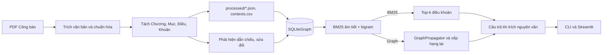
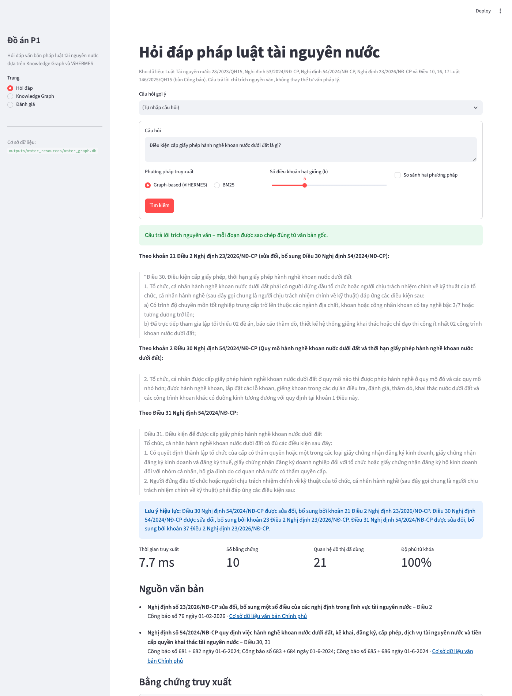
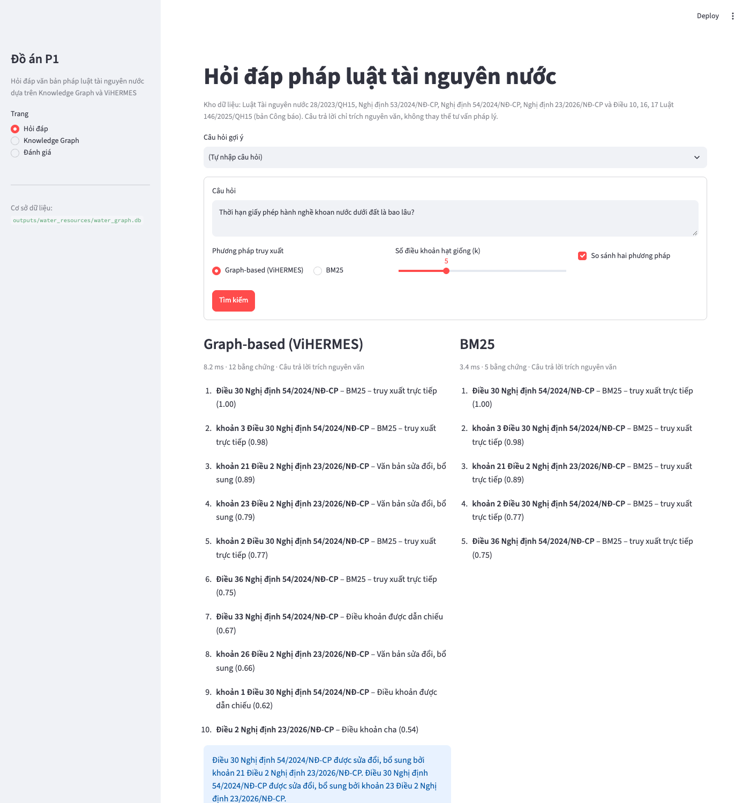
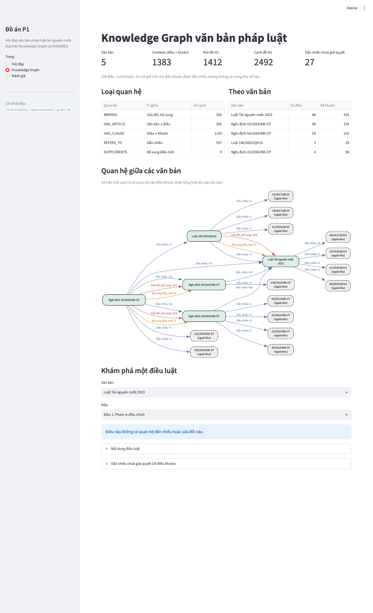
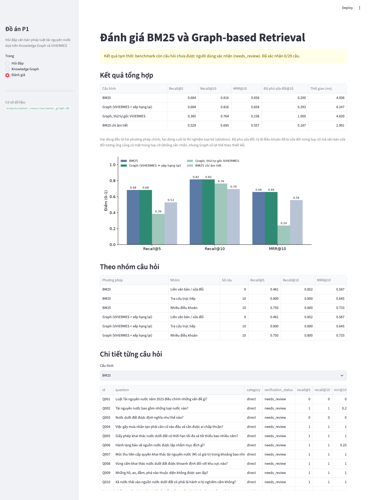
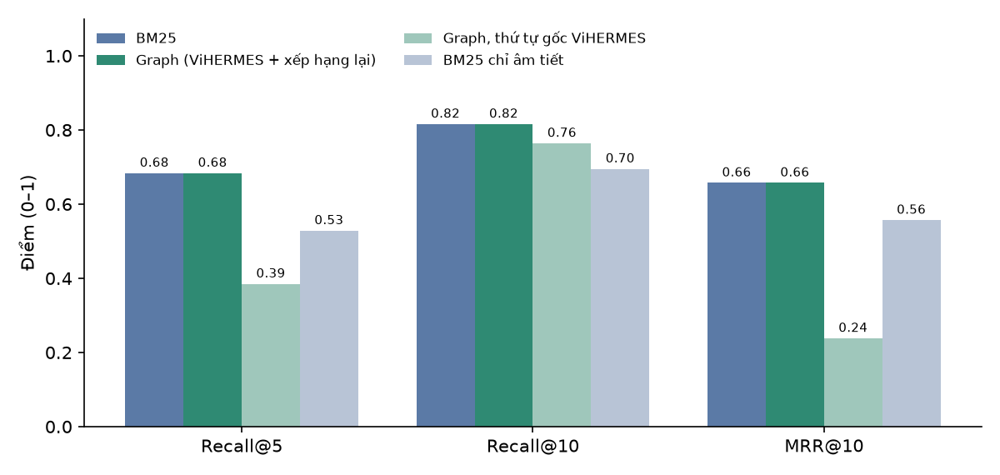

# BÁO CÁO ĐỒ ÁN KẾT THÚC MÔN HỌC (P1)

**Đề tài:** Xây dựng hệ thống hỏi đáp về văn bản pháp luật tài nguyên nước tại Việt Nam dựa trên Knowledge Graph và ViHERMES

|                      |                                               |
| :------------------- | :-------------------------------------------- |
| Môn học              | Xử lý ngôn ngữ tự nhiên                       |
| Học viên             | _(điền họ tên, mã số học viên)_               |
| Giảng viên hướng dẫn | _(điền)_                                      |
| Thời điểm thực hiện  | Tháng 10/2026                                 |
| Mã nguồn             | Repository ViHERMES, gói con `vihermes.water` |

> Mọi số liệu trong báo cáo được đo trực tiếp từ dữ liệu và mã nguồn của dự án (lệnh tái tạo ở Phụ lục A). Bộ câu hỏi đánh giá do người thực hiện soạn từ văn bản thật và **chưa được xác nhận độc lập**, nên kết quả ở Chương 4 là **kết quả tạm thời**.

---

> **Ghi chú phiên bản (12/11/2026):** báo cáo này mô tả phiên bản 1. Phiên bản 2 đã sửa lỗi bãi bỏ chưa được phân tích và 2 cạnh `AMENDS` sai nêu trong các ghi chú trước, đồng thời bổ sung truy xuất thần kinh, Knowledge Graph hiệu lực theo thời gian và 33 câu hỏi mới. Số liệu đồ thị và đánh giá của phiên bản 2 khác các bảng dưới đây; xem [`BAO_CAO_NANG_CAP.md`](BAO_CAO_NANG_CAP.md).

## Chương 1. Giới thiệu

### 1.1. Lý do chọn đề tài

Luật Tài nguyên nước số 28/2023/QH15 có hiệu lực từ ngày 01/7/2024 và được hướng dẫn bởi nhiều nghị định. Chỉ hơn một năm sau, hệ thống văn bản này đã thay đổi đáng kể. Luật số 146/2025/QH15 sửa đổi Luật Tài nguyên nước cùng 14 luật khác. Nghị định 23/2026/NĐ-CP sửa đổi đồng thời hai nghị định hướng dẫn là 53/2024/NĐ-CP và 54/2024/NĐ-CP. Theo đồ thị xây dựng trong đồ án, **71/98 điều** của Nghị định 53, **49/59 điều** của Nghị định 54 và **44/86 điều** của Luật 28 có ít nhất một quan hệ sửa đổi hoặc bổ sung, tính cả các thay đổi chỉ thay thế cụm từ.

Người tra cứu vì thế gặp hai khó khăn:

1. Một câu hỏi thường cần nhiều điều khoản: điều của Luật, điều tương ứng ở nghị định hướng dẫn, và điều khoản sửa đổi.
2. Văn bản gốc vẫn được đăng tải, nhưng một phần nội dung đã bị sửa. Tìm kiếm theo từ khóa có thể trả về đúng điều khoản gốc mà không cho biết điều khoản đó đã thay đổi.

Knowledge Graph biểu diễn trực tiếp quan hệ "Điều A dẫn chiếu Điều B" và "Điều A được sửa đổi bởi khoản C", nên phù hợp với hai khó khăn trên. ViHERMES là mã nguồn mở đã hiện thực mô hình đồ thị pháp luật có cấu trúc (SRKG) cho văn bản y tế tiếng Việt. Đồ án tái sử dụng ViHERMES cho lĩnh vực tài nguyên nước.

### 1.2. Mục tiêu

1. Thu thập 3–5 văn bản pháp luật chính thức về tài nguyên nước, giữ nguyên nội dung và nguồn gốc.
2. Xây dựng quy trình chuyển PDF Công báo thành các đơn vị điều, khoản có mã định danh ổn định.
3. Xây dựng Knowledge Graph bằng thành phần đồ thị của ViHERMES, gồm quan hệ cấu trúc, dẫn chiếu và sửa đổi.
4. Xây dựng hệ thống hỏi đáp tiếng Việt với hai chế độ truy xuất (BM25 và Graph). Câu trả lời trích nguyên văn kèm nguồn.
5. Đánh giá hai chế độ trên bộ câu hỏi nhỏ và xây dựng giao diện demo.

### 1.3. Phạm vi

- **Dữ liệu**: 5 văn bản (Bảng 4.2); chỉ phần nội dung quy phạm, không gồm phụ lục mẫu biểu; không dùng văn bản scan.
- **Phương pháp**: truy xuất từ vựng (BM25) và truy xuất dựa trên đồ thị. Không dùng mô hình nhúng (embedding), mô hình ngôn ngữ lớn hay API trả phí. Chạy được trên máy cá nhân, không cần GPU.
- **Câu trả lời**: trích nguyên văn (extractive). Hệ thống không diễn giải, không suy luận pháp lý và không tạo văn bản hợp nhất.

### 1.4. Bài toán

**Đầu vào**: một câu hỏi tiếng Việt về pháp luật tài nguyên nước.

**Đầu ra**:

- Danh sách điều, khoản liên quan, xếp hạng theo độ liên quan (bằng chứng).
- Câu trả lời gồm 1–3 đoạn trích nguyên văn, mỗi đoạn ghi rõ khoản, điều, văn bản.
- Danh sách văn bản nguồn kèm liên kết chính thức.
- Ghi chú hiệu lực khi điều khoản được trích đã bị sửa đổi (chế độ Graph).
- Trạng thái "chỉ có bằng chứng tham khảo" khi không đủ căn cứ trả lời trực tiếp.

**Bài toán đánh giá**: với mỗi câu hỏi có tập điều khoản kỳ vọng, đo khả năng đưa các điều khoản đó vào đầu danh sách (Recall@k, MRR@10) và thời gian truy xuất của từng phương pháp.

---

## Chương 2. Cơ sở lý thuyết

### 2.1. Knowledge Graph

Knowledge Graph biểu diễn tri thức bằng đồ thị có hướng $G = (V, E)$. Mỗi nút $v \in V$ là một thực thể, mỗi cạnh $(u, r, v) \in E$ là một quan hệ có kiểu $r$. Với văn bản pháp luật, cấu trúc phân cấp tự nhiên là **Văn bản → Điều → Khoản → Điểm**, và các điều khoản liên kết với nhau bằng:

- **Dẫn chiếu**: "theo quy định tại khoản 2 Điều 9 của Luật này".
- **Hướng dẫn thi hành**: nghị định "quy định chi tiết Điều 7, khoản 5 Điều 9 … của Luật Tài nguyên nước".
- **Sửa đổi, bổ sung, bãi bỏ**: "Sửa đổi, bổ sung khoản 3 Điều 12 như sau: …".

Biểu diễn bằng đồ thị cho phép đi từ một điều khoản tìm được tới các điều khoản liên quan theo quan hệ có kiểu. Tìm kiếm văn bản phẳng không làm được việc này.

### 2.2. BM25

BM25 (Robertson và Zaragoza, 2009) chấm điểm văn bản $d$ cho truy vấn $q$:

$$
\text{BM25}(q, d) = \sum_{t \in q} \text{idf}(t) \cdot \frac{f(t,d)\,(k_1 + 1)}{f(t,d) + k_1\left(1 - b + b\,\frac{|d|}{\text{avgdl}}\right)}, \qquad \text{idf}(t) = \ln\!\left(1 + \frac{N - n_t + 0{,}5}{n_t + 0{,}5}\right)
$$

trong đó $f(t,d)$ là tần suất của từ $t$ trong $d$, $n_t$ là số văn bản chứa $t$, $N$ là tổng số văn bản, $|d|$ là độ dài văn bản. ViHERMES dùng $k_1 = 1{,}5$ và $b = 0{,}75$.

Tiếng Việt viết cách nhau theo **âm tiết**, nhưng một từ thường gồm nhiều âm tiết ("nước dưới đất", "khai thác", "tiền cấp quyền"). Tách theo âm tiết làm mất ranh giới từ. Đồ án bổ sung **cặp âm tiết liền kề (bigram)** vào tập từ của BM25, ví dụ "khai*thác", "dưới*đất". Cách này khôi phục phần lớn từ ghép mà không cần bộ tách từ.

### 2.3. Graph-based Retrieval

Truy xuất dựa trên đồ thị thường gồm ba bước:

1. **Gieo hạt (seeding)**: tìm các nút ban đầu bằng một phương pháp cơ sở (ở đây là BM25).
2. **Lan truyền (propagation)**: mở rộng sang các nút có quan hệ với nút hạt giống, với giới hạn về độ sâu và số nút.
3. **Xếp hạng**: kết hợp độ liên quan của nút hạt giống, kiểu quan hệ và độ liên quan riêng của nút được mở rộng.

Các hệ thống như HippoRAG 2 hay LightRAG dùng đồ thị thực thể do mô hình ngôn ngữ trích xuất. ViHERMES dùng đồ thị cấu trúc của chính văn bản pháp luật. Đồ án đi theo cách của ViHERMES vì cấu trúc này có sẵn, chính xác và giải thích được.

### 2.4. ViHERMES

ViHERMES (Nguyen và cộng sự, ACIIDS 2026) là hệ thống hỏi đáp đa bước cho văn bản pháp luật y tế tiếng Việt. Các thành phần chính:

| Thành phần ViHERMES                         | Vai trò                                                                                                                     | Đồ án sử dụng                |
| :------------------------------------------ | :-------------------------------------------------------------------------------------------------------------------------- | :--------------------------- |
| `Node`, `Edge` (`models.py`)                | Nút Document/Article/Clause; quan hệ `HAS_ARTICLE`, `HAS_CLAUSE`, `REFERS_TO`, `AMENDS`, `REPLACES`, `SUPPLEMENTS`          | Có                           |
| Mã định danh ổn định                        | `28/2023/QH15::article:9::clause:2`                                                                                         | Có                           |
| `SQLiteGraph` (`graph.py`)                  | Lưu đồ thị trong SQLite, tự tạo nút giữ chỗ cho tham chiếu chưa có                                                          | Có                           |
| `HybridRetriever`, `BM25` (`retrieval.py`)  | Xếp hạng hạt giống kết hợp BM25 và vector; trọng số 0 nghĩa là chỉ dùng BM25                                                | Có (thay tập từ của BM25)    |
| `GraphPropagator`                           | Lan truyền đệ quy theo `AMENDS/REPLACES/SUPPLEMENTS` (tối đa 4 bước), mở rộng `REFERS_TO` 1 bước, thêm nút cha (provenance) | Có                           |
| `Pathfinder`, `Plan` (`agents.py`)          | Ghép bước gieo hạt và bước lan truyền                                                                                       | Có                           |
| `parse_document`, `ingest` (`ingestion.py`) | Tách điều, khoản bằng biểu thức chính quy                                                                                   | Không, xem 3.3               |
| `Interpreter`, `Auditor`, `Conductor`       | Tác tử dùng LLM để phân tích câu hỏi, sinh và kiểm chứng câu trả lời                                                        | Không (đồ án không dùng LLM) |

Theo quy ước của ViHERMES, cạnh hiệu lực hướng từ **điều khoản bị tác động tới điều khoản sửa đổi**. "Khoản 21 Điều 2 Nghị định 23 sửa đổi Điều 30 Nghị định 54" được lưu thành `54/2024/NĐ-CP::article:30 → 23/2026/NĐ-CP::article:2::clause:21` (`AMENDS`). Khi lan truyền từ Điều 30, hệ thống tìm được văn bản sửa đổi.

---

## Chương 3. Phân tích và thiết kế

### 3.1. Kiến trúc hệ thống



_Hình 3.1. Kiến trúc tổng thể._

| Mô-đun (`src/vihermes/water/`)   | Chức năng                                                  | Phần ViHERMES được dùng                                    |
| :------------------------------- | :--------------------------------------------------------- | :--------------------------------------------------------- |
| `sources.py`                     | Danh mục nguồn, tải tệp, kiểm tra SHA-256                  | —                                                          |
| `pdftext.py`                     | Trích dòng từ PDF, bỏ phần trang trí, chuẩn hóa, ghép đoạn | —                                                          |
| `structure.py`                   | Tách cấu trúc pháp lý                                      | —                                                          |
| `links.py`                       | Quan hệ dẫn chiếu, sửa đổi, bổ sung                        | `Edge`, `DOCUMENT_CODE`                                    |
| `corpus.py`                      | Ghi dữ liệu, nạp đồ thị, thống kê                          | `Node`, `Edge`, `SQLiteGraph`                              |
| `lexical.py`                     | BM25 âm tiết + bigram                                      | Kế thừa `BM25`                                             |
| `qa.py`                          | Truy xuất hai chế độ, soạn câu trả lời                     | `HybridRetriever`, `GraphPropagator`, `Pathfinder`, `Plan` |
| `benchmark.py`                   | Đánh giá                                                   | —                                                          |
| `cli.py`, `app/streamlit_app.py` | Giao diện dòng lệnh và web                                 | —                                                          |

Mã nguồn gốc của ViHERMES không bị sửa. Phần mở rộng là một gói con độc lập, khai báo nhóm phụ thuộc `water` và lệnh `vihermes-water` trong `pyproject.toml`.

### 3.2. Mô hình dữ liệu

**Mã định danh** theo quy ước ViHERMES:

| Loại nút | Ví dụ                                 |
| :------- | :------------------------------------ |
| Document | `53/2024/NĐ-CP`                       |
| Article  | `53/2024/NĐ-CP::article:33`           |
| Clause   | `53/2024/NĐ-CP::article:33::clause:1` |

**Nút** (`Node`): `id`, `document_id`, `kind`, `title` (tên văn bản), `text`, `metadata`, `placeholder`. `metadata` lưu số hiệu, tên ngắn, loại văn bản, cơ quan ban hành, ngày ban hành, ngày hiệu lực, URL nguồn chính thức, số Công báo, số điều, số khoản, tiêu đề điều, chương và mục. Văn bản của nút Điều gồm tiêu đề và toàn bộ các khoản, giống `parse_document` của ViHERMES. Văn bản của nút Văn bản là phần mở đầu (căn cứ ban hành).

**Cạnh**:

| Quan hệ       | Hướng                                                                          | Cách tạo                                    |
| :------------ | :----------------------------------------------------------------------------- | :------------------------------------------ |
| `HAS_ARTICLE` | Văn bản → Điều                                                                 | Cấu trúc                                    |
| `HAS_CLAUSE`  | Điều → Khoản                                                                   | Cấu trúc                                    |
| `REFERS_TO`   | Điều khoản dẫn chiếu → điều khoản được dẫn chiếu; Văn bản → văn bản làm căn cứ | Quy tắc trên văn bản                        |
| `AMENDS`      | Điều khoản bị sửa, bãi bỏ, thay thế cụm từ → khoản sửa đổi                     | Câu lệnh "Sửa đổi…", "Thay thế…", "Bãi bỏ…" |
| `SUPPLEMENTS` | Điều làm mốc → khoản bổ sung điều mới (ví dụ Điều 8 → khoản bổ sung Điều 8a)   | Câu lệnh "Bổ sung…"                         |

**Tệp dữ liệu**:

- `sources.json`: danh mục 5 văn bản (số hiệu, tiêu đề, cơ quan, người ký, ngày ban hành, ngày hiệu lực, URL trang văn bản, danh sách tệp PDF kèm URL, số Công báo, SHA-256), danh sách điều được trích (Luật 146) và văn bản bị loại (QĐ 274/QĐ-TTg).
- `processed/<văn bản>.json`: phần mở đầu, danh sách điều (số, tiêu đề, chương, mục, các đoạn mở đầu, các khoản), cảnh báo khi tách.
- `contexts.csv`: một dòng cho mỗi điều hoặc khoản, gồm các cột `context_id, document_id, kind, article, clause, title, article_title, text, source_url`. Ba cột `context_id, title, text` tương thích với định dạng CSV của ViHERMES.

### 3.3. Quy trình xử lý văn bản

**Bước 1: Trích dòng.** PyMuPDF trả về từng dòng hiển thị kèm tọa độ, phông chữ và cờ in đậm. Các dòng bị tách ở cùng độ cao được gộp lại.

**Bước 2: Bỏ phần trang trí.** Hệ thống bỏ tiêu đề trang ("CÔNG BÁO/Số 41 + 42/Ngày 08-01-2024"), số trang ở đầu và cuối trang, khối chữ ký số ("Người ký: CỔNG THÔNG TIN ĐIỆN TỬ CHÍNH PHỦ…") và dòng "VĂN BẢN QUY PHẠM PHÁP LUẬT". Văn bản đăng trên nhiều số Công báo được nối lại, phần tiêu đề lặp "(Tiếp theo Công báo số …)" ở các phần sau bị bỏ.

**Bước 3: Chuẩn hóa ký tự.** Hệ thống chuẩn hóa Unicode NFC, thay khoảng trắng đặc biệt, bỏ ký tự điều khiển, ký tự vùng riêng và U+FFFD. Ký tự "Ð" (U+00D0, chữ eth) được thay bằng "Đ" (U+0110). Lỗi này có thật trong Công báo: tiêu đề Điều 88 Nghị định 53 dùng "Ðiều", làm điều này biến mất nếu không xử lý.

**Bước 4: Ghép dòng thành đoạn.** PDF ngắt dòng cứng. Nếu ghép sai, một dòng bắt đầu bằng "2024. …" có thể bị nhận nhầm là "khoản 2024". Công báo thụt lề dòng đầu đoạn (x ≈ 87pt) so với lề trái (x ≈ 64pt). Hệ thống ước lượng lề trái cho từng trang: đó là vị trí xuất hiện ít nhất hai lần ở các dòng dài và có một vị trí thụt lề nằm cách nó 15–45pt về bên phải. Trang không có mẫu này (ví dụ trang toàn danh sách một dòng) dùng lề của trang trước. Dòng thụt lề mở đoạn mới. Dòng bắt đầu bằng chữ thường (trừ "a)", "đ)") luôn là dòng nối tiếp, để xử lý các trang Luật 146 đổi bố cục giữa trang.

**Bước 5: Tách cấu trúc.** Duyệt các đoạn và nhận diện "Chương …", "Mục …", "Điều N." và "N." (khoản). Ba ràng buộc giúp tránh nhận nhầm:

- **Văn bản trích dẫn**: văn bản sửa đổi chứa nguyên văn điều mới trong ngoặc kép ("“Điều 30. Điều kiện cấp giấy phép…”"). Hệ thống theo dõi độ sâu ngoặc kép, và các tiêu đề nằm trong ngoặc không mở điều mới. Ngoặc kép thẳng `"` đóng ngoặc đang mở, nếu không có ngoặc nào đang mở thì nó mở ngoặc mới. Nếu gặp câu lệnh sửa đổi ("33. Sửa đổi, bổ sung … như sau:") khi đang trong ngoặc, độ sâu được đặt lại.
- **Số thứ tự liên tiếp**: Điều chỉ được chấp nhận nếu số tăng đúng 1 (cho phép dạng 10a); khoản cũng vậy trong phạm vi một điều. Ràng buộc này phát hiện được "Điều 50." trong Nghị định 23, vốn mất dấu ngoặc mở ngay trong bản Công báo.
- **Kết thúc phần nội dung**: tại "TM. CHÍNH PHỦ", "CHỦ TỊCH QUỐC HỘI", "Luật này được Quốc hội …" hoặc tiêu đề "Phụ lục". Phần sau đó không thuộc điều nào.

**Bước 6: Kiểm tra.** Không có context rỗng, không trùng mã, văn bản ở dạng NFC, mã context bắt đầu bằng số hiệu văn bản. Số điều tách được khớp với văn bản gốc: Luật 28 có 86 điều, NĐ 53 có 98 điều, NĐ 54 có 59 điều, NĐ 23 có 4 điều với 45 + 38 + 10 + 5 khoản, Luật 146 có 17 điều. Các con số này được kiểm tra trong `tests/test_water.py`.

Đồ án không dùng `parse_document` của ViHERMES vì hàm này coi mọi dòng "N." là khoản. Với văn bản sửa đổi, các khoản trong phần trích dẫn trùng số với khoản của chính văn bản sửa đổi, khiến hàm báo lỗi trùng mã. Hàm cũng không xử lý tiêu đề trang, chữ ký số hay phụ lục.

### 3.4. Quy trình xây dựng Knowledge Graph

1. **Nút và quan hệ cấu trúc**: tạo nút cho mỗi văn bản, điều, khoản, cùng các cạnh `HAS_ARTICLE` và `HAS_CLAUSE`.
2. **Dẫn chiếu** (`REFERS_TO`): tìm các cụm "[các] khoản K[, K…] Điều N" và nhóm các cụm liền nhau ("khoản 2, khoản 3 Điều 5 và Điều 7") thành một chuỗi. Cụm định danh văn bản đứng ngay sau chuỗi áp dụng cho cả chuỗi:
   - "của Luật này", "Nghị định này": văn bản hiện tại;
   - "Nghị định số 54/2024/NĐ-CP": theo số hiệu;
   - "Luật Tài nguyên nước": theo tên gọi khai báo trong `sources.json`. Tên kèm năm khác ("… năm 2012") bị loại để không nhầm với luật cũ;
   - không có cụm định danh: văn bản hiện tại.

   "khoản K Điều này" trỏ tới khoản của chính điều đó. Đích là khoản nếu khoản tồn tại, ngược lại là điều. Điều khoản dẫn chiếu tới chính nó hoặc tới điều cha của nó bị bỏ qua.

3. **Sửa đổi** (`AMENDS`, `SUPPLEMENTS`): điều có tiêu đề "Sửa đổi, bổ sung một số điều của …" là điều sửa đổi, và văn bản bị sửa được xác định từ tiêu đề. Mỗi khoản của điều này được tách thành:
   - **câu lệnh** (phần ngoài ngoặc kép): tạo cạnh hiệu lực từ các điều, khoản được nêu tới khoản sửa đổi. "Bổ sung" tạo `SUPPLEMENTS`; "Sửa đổi", "Thay thế", "Bãi bỏ" tạo `AMENDS`. Điều mới (8a) được gắn vào điều làm mốc (8). "khoản K" không kèm điều thuộc về điều duy nhất được nêu trong câu lệnh;
   - **nội dung trích dẫn**: tạo dẫn chiếu với "văn bản hiện tại" là văn bản bị sửa, vì "Nghị định này" trong nội dung trích dẫn của NĐ 23 chỉ NĐ 53 hoặc NĐ 54.

   Câu lệnh sửa đổi, bãi bỏ nằm ở điều khác (ví dụ khoản 3, 4 Điều 4 NĐ 23 bãi bỏ quy định của NĐ 131/2025 và NĐ 136/2025) được xử lý theo cùng cách với văn bản đích tương ứng.

4. **Căn cứ ban hành**: dòng "Căn cứ Luật …" trong phần mở đầu tạo cạnh `REFERS_TO` cấp văn bản tới văn bản trong kho.
5. **Tham chiếu chưa giải quyết**: `SQLiteGraph` tự tạo nút giữ chỗ cho điều khoản được dẫn chiếu nhưng không có trong kho, như văn bản khác, điều mới chỉ tồn tại trong nội dung trích dẫn, hoặc điều của Luật 146 không được trích. Các nút này được thống kê riêng.
6. **Ghi cơ sở dữ liệu riêng** `outputs/water_resources/water_graph.db`. Dữ liệu được ghi vào tệp tạm rồi thay thế, và bảng `water_meta` đánh dấu cơ sở dữ liệu do dự án tạo. Lệnh từ chối ghi đè cơ sở dữ liệu không mang dấu này (như `outputs/vihermes.db`).

### 3.5. Quy trình hỏi đáp

1. **Kiểm tra đầu vào**: câu hỏi rỗng trả về `empty_question`, không gọi truy xuất.
2. **Gợi ý văn bản**: số hiệu ("54/2024/NĐ-CP" hoặc "54/2024") và tên gọi ("Luật Tài nguyên nước") trong câu hỏi được truyền cho ViHERMES dưới dạng gợi ý xếp hạng (+0,1 điểm), không phải bộ lọc. Gợi ý theo tên cần thiết vì Luật tự gọi mình là "Luật này", trong khi tên "Luật Tài nguyên nước" xuất hiện dày đặc trong các nghị định.
3. **Gieo hạt**: `HybridRetriever` với trọng số vector 0 (chỉ BM25) và BM25 trên âm tiết + bigram trả về k điều khoản có điểm cao nhất.
4. **Chế độ BM25**: dùng ngay danh sách hạt giống.
5. **Chế độ Graph**: `GraphPropagator` mở rộng hạt giống. Nút sửa đổi nhận nguyên điểm của hạt giống, nút được dẫn chiếu nhận 0,8 lần, nút cha nhận 0,7 lần. Sau đó mỗi nút được mở rộng được chấm lại:

   $$
   \text{score}(v) = 0{,}5 \cdot \text{BM25}_{\text{chuẩn hóa}}(v) + 0{,}5 \cdot \text{score}_{\text{lan truyền}}(v)
   $$

   rồi xếp hạng chung với hạt giống theo điểm. Hệ số 0,5 không được tinh chỉnh; dạng trung bình được chọn sau khi thử dạng lấy giá trị lớn nhất trong quá trình phát triển. Bước này cần thiết vì `GraphPropagator` của ViHERMES luôn đặt mọi nút sửa đổi ở cuối chuỗi hiệu lực lên đầu danh sách. Thứ tự đó phù hợp khi ghép ngữ cảnh cho LLM nhưng làm giảm mạnh chất lượng xếp hạng (mục 4.7).

6. **Soạn câu trả lời trích dẫn**:
   - Ứng viên là từng dòng của các bằng chứng đầu tiên, câu dài được tách theo dấu câu.
   - Độ phủ của một ứng viên là tổng IDF của các âm tiết và bigram trong câu hỏi xuất hiện trong ứng viên, chia cho tổng IDF của câu hỏi. Từ để hỏi bị loại. Âm tiết không có trong kho nhận IDF lớn nhất, để câu hỏi ngoài phạm vi có độ phủ thấp.
   - Điểm = 0,75 × độ phủ của ứng viên + 0,25 × độ phủ của tiêu đề điều, trừ một lượng nhỏ theo thứ hạng bằng chứng.
   - Tiêu đề điều, tiêu đề khoản và câu dẫn kết thúc bằng ":" được trích kèm các dòng tiếp theo (tối đa 700 ký tự).
   - Đoạn trích lấy từ văn bản của một điều được ghi nguồn tới đúng khoản chứa nó.
   - Nếu độ phủ của đoạn tốt nhất dưới 0,35, hệ thống không trả lời mà chỉ liệt kê điều khoản tham khảo (`reference_only`).

7. **Nguồn và cảnh báo**: nhóm nguồn theo văn bản, kèm URL trang văn bản trên vanban.chinhphu.vn và số Công báo. Ở chế độ Graph, cạnh `AMENDS`/`SUPPLEMENTS` liên quan tới điều khoản được trích tạo câu "Điều X … được sửa đổi, bổ sung bởi khoản Y …". Tham chiếu chưa giải quyết được báo trong `warnings`.

Mọi đoạn trích là chuỗi con nguyên văn của văn bản đã lưu. Tính chất này được kiểm thử tự động.

---

## Chương 4. Cài đặt và thực nghiệm

### 4.1. Môi trường thực hiện

| Hạng mục      | Giá trị                             |
| :------------ | :---------------------------------- |
| Hệ điều hành  | macOS (Darwin 25.4)                 |
| Python        | 3.14.3 (môi trường ảo `.venv`)      |
| Phần cứng     | CPU, không dùng GPU                 |
| Dịch vụ ngoài | Không. Chỉ cần mạng khi tải lại PDF |

### 4.2. Công nghệ sử dụng

| Thư viện     | Phiên bản     | Vai trò                  |
| :----------- | :------------ | :----------------------- |
| ViHERMES     | 0.2.0         | Đồ thị, BM25, lan truyền |
| NumPy        | 2.5.4         | Tính điểm BM25           |
| PyMuPDF      | 2.0           | Đọc PDF                  |
| Streamlit    | 1.66.1        | Giao diện                |
| pandas       | 3.1.0         | Bảng trong giao diện     |
| Matplotlib   | 3.11.2        | Biểu đồ đánh giá         |
| pytest, ruff | 8.4.2, 0.17.2 | Kiểm thử, kiểm tra mã    |

### 4.3. Dữ liệu thử nghiệm

Năm văn bản được tải từ máy chủ Công báo và tệp đính kèm của Cơ sở dữ liệu văn bản pháp luật Chính phủ (`congbaocdn.chinhphu.vn`, `datafiles.chinhphu.vn`). Thông tin số hiệu, ngày ban hành, ngày hiệu lực và người ký được đối chiếu trên trang văn bản của vanban.chinhphu.vn. Trang vbpl.vn từ chối truy cập tự động (HTTP 403) nên không được dùng. Các tệp đính kèm trên vanban.chinhphu.vn của NĐ 53, NĐ 54 và QĐ 274/QĐ-TTg là bản scan, nên đồ án dùng bản Công báo có lớp văn bản. QĐ 274 không có bản Công báo và bị loại.

_Bảng 4.1. Kho văn bản và kết quả tách._

| Văn bản                              | Ban hành / hiệu lực     | Số trang PDF |    Điều |     Khoản |  Contexts |
| :----------------------------------- | :---------------------- | -----------: | ------: | --------: | --------: |
| Luật Tài nguyên nước 28/2023/QH15    | 27/11/2023 / 01/7/2024  |           74 |      86 |       418 |       504 |
| Nghị định 53/2024/NĐ-CP              | 16/5/2024 / 01/7/2024   |      95 + 18 |      98 |       378 |       476 |
| Nghị định 54/2024/NĐ-CP              | 16/5/2024 / 01/7/2024   | 95 + 95 + 70 |      59 |       210 |       269 |
| Nghị định 23/2026/NĐ-CP              | 17/01/2026 / 17/01/2026 |          226 |       4 |        98 |       102 |
| Luật 146/2025/QH15 (Điều 10, 16, 17) | 11/12/2025 / 01/01/2026 |           80 |  3 / 17 |        29 |        32 |
| **Tổng**                             |                         |              | **250** | **1.133** | **1.383** |

Phần lớn số trang của NĐ 54 và NĐ 23 là phụ lục mẫu biểu, không được đưa vào kho. Một khoản dài trung vị 327 ký tự. Một điều dài trung vị 1.663 ký tự; điều dài nhất là Điều 1 NĐ 23 với 68.900 ký tự, vì chứa toàn bộ 45 khoản sửa đổi NĐ 53.

_Bảng 4.2. Thống kê Knowledge Graph (đọc từ cơ sở dữ liệu)._

| Chỉ số                                  |                                                                                                       Giá trị |
| :-------------------------------------- | ------------------------------------------------------------------------------------------------------------: |
| Văn bản trong kho                       |                                                                                                             5 |
| Contexts (nút điều + khoản có nội dung) |                                                                                                         1.383 |
| Tổng số nút (kể cả 24 nút giữ chỗ)      |                                                                                                         1.412 |
| Tổng số cạnh                            |                                                                                                         2.492 |
| `HAS_ARTICLE` / `HAS_CLAUSE`            |                                                                                                   250 / 1.133 |
| `REFERS_TO`                             |                                                                                                           597 |
| `AMENDS` / `SUPPLEMENTS`                |                                                                                                       503 / 9 |
| Cạnh tới điều khoản chưa có trong kho   | 27 (18 tới văn bản ngoài kho, 9 tới điều 8a–8d, 10a do NĐ 23 bổ sung và Điều 8, 14 Luật 146 không được trích) |

_Bảng 4.3. Quan hệ giữa các văn bản trong kho (tổng hợp từ cạnh cấp điều, khoản; chiều "văn bản nguồn → văn bản đích")._

| Quan hệ                                           |      Số cạnh |
| :------------------------------------------------ | -----------: |
| NĐ 53 → Luật 28: dẫn chiếu                        |           50 |
| NĐ 54 → Luật 28: dẫn chiếu                        |           33 |
| NĐ 23 → NĐ 53: sửa đổi / bổ sung / dẫn chiếu      | 214 / 3 / 31 |
| NĐ 23 → NĐ 54: sửa đổi / bổ sung / dẫn chiếu      | 131 / 4 / 41 |
| NĐ 23 → Luật 28: dẫn chiếu                        |           37 |
| Luật 146 → Luật 28: sửa đổi / bổ sung / dẫn chiếu |  158 / 2 / 2 |

Kiểm tra thủ công 20 cạnh chọn ngẫu nhiên (12 `REFERS_TO`, 8 `AMENDS`, hạt giống ngẫu nhiên 7) cho thấy cả 20 cạnh khớp với câu chữ của văn bản, ví dụ "khoản 2 Điều 8 của Nghị định này" trong nội dung trích dẫn của NĐ 23 được nối đúng tới `54/2024/NĐ-CP::article:8::clause:2`, và "các khoản 1, 2, 3, 4, 5 và 6 Điều này" được nối tới từng khoản. Mẫu nhỏ, chỉ mang tính kiểm tra hợp lý.

### 4.4. Hình ảnh giao diện



_Hình 4.1. Trang Hỏi đáp, chế độ Graph, câu hỏi "Điều kiện cấp giấy phép hành nghề khoan nước dưới đất là gì?". Đoạn trích đầu tiên lấy từ khoản 21 Điều 2 NĐ 23/2026, điều khoản sửa đổi Điều 30 NĐ 54. Hộp "Lưu ý hiệu lực" cho biết Điều 30 đã bị sửa đổi._



_Hình 4.2. So sánh hai phương pháp cho câu hỏi "Thời hạn giấy phép hành nghề khoan nước dưới đất là bao lâu?". Chế độ Graph bổ sung khoản 21 và khoản 23 Điều 2 NĐ 23 (văn bản sửa đổi Điều 30 NĐ 54) cùng ghi chú hiệu lực._



_Hình 4.3. Trang Knowledge Graph: thống kê, loại quan hệ, đồ thị giữa các văn bản và đồ thị lân cận của một điều._



_Hình 4.4. Trang Đánh giá với cảnh báo kết quả tạm thời._

### 4.5. Ví dụ hỏi đáp

Các ví dụ dưới đây là đầu ra thật của hệ thống (chế độ Graph, k = 5); đoạn dài được rút gọn bằng "…".

**Ví dụ 1. Tra cứu trực tiếp, trả lời đúng.**
Câu hỏi: _Mức thu tiền cấp quyền khai thác tài nguyên nước (M) có giá trị trong khoảng bao nhiêu?_

> Theo Điều 45 Nghị định 54/2024/NĐ-CP: "Mức thu tiền cấp quyền khai thác tài nguyên nước (M) căn cứ vào mục đích sử dụng nước, loại nguồn nước có giá trị từ 0,05% đến 2,0%, được quy định cụ thể tại Phụ lục V ban hành kèm theo Nghị định này."

**Ví dụ 2. Điều khoản đã bị sửa đổi.**
Câu hỏi: _Khoản 5 Điều 8 Luật Tài nguyên nước về hành vi lấn, lấp sông, suối đã được sửa đổi như thế nào?_

> Theo khoản 1 Điều 10 Luật 146/2025/QH15 (sửa đổi, bổ sung Điều 8 Luật Tài nguyên nước 2023): "5. Lấn, lấp sông, suối, kênh, mương, rạch nhưng không có biện pháp khắc phục, trừ trường hợp pháp luật có quy định khác; …"
> Theo khoản 5 Điều 8 Luật Tài nguyên nước 2023 (Các hành vi bị nghiêm cấm): "5. Lấn, lấp sông, suối, kênh, mương, rạch, trừ trường hợp pháp luật có quy định khác; …"
> Lưu ý: Điều 8 Luật Tài nguyên nước 2023 được sửa đổi, bổ sung bởi khoản 1 Điều 10 Luật 146/2025/QH15.

Hai đoạn trích đặt cạnh nhau cho thấy nội dung được thêm vào là "nhưng không có biện pháp khắc phục". Chế độ BM25 trả về cùng hai đoạn trích nhưng không có dòng "Lưu ý".

**Ví dụ 3. Câu hỏi ngoài phạm vi.**
Câu hỏi: _Giá vé xem bóng đá năm nay là bao nhiêu?_

> Chưa tìm thấy đoạn văn trả lời trực tiếp câu hỏi. Các điều khoản dưới đây là bằng chứng tham khảo gần nhất: khoản 2 Điều 48 Nghị định 54/2024/NĐ-CP (Giá tính tiền cấp quyền khai thác tài nguyên nước (G)); …

Độ phủ chỉ đạt 0,19, dưới ngưỡng 0,35, nên hệ thống không đưa ra câu trả lời.

**Ví dụ 4. Trường hợp trả lời sai.**
Câu hỏi: _Tài nguyên nước bao gồm những loại nước nào?_

> Theo khoản 3 Điều 49 Nghị định 54/2024/NĐ-CP (Hệ số điều chỉnh (K)): "3. Hệ số loại nguồn nước khai thác (K2) được xác định theo loại nguồn nước bao gồm nước mặt, nước dưới đất do tổ chức, cá nhân khai thác."

Đáp án đúng là khoản 1 Điều 2 Luật 28: "Tài nguyên nước bao gồm nước mặt, nước dưới đất, nước mưa và nước biển." Khoản này nằm ở vị trí thứ 5 trong danh sách bằng chứng, nhưng đoạn trích ở Điều 49 chứa thêm từ "loại" của câu hỏi nên được chọn. Đây là hạn chế của cách chọn đoạn dựa trên từ vựng; người dùng cần xem danh sách bằng chứng.

### 4.6. Thiết kế benchmark

- **Câu hỏi**: 29 câu do người thực hiện soạn sau khi đọc văn bản. 10 câu tra cứu trực tiếp, 10 câu cần nhiều điều khoản, 9 câu cần liên kết văn bản hoặc lần theo quan hệ sửa đổi.
- **Nhãn**: mỗi câu có `expected_context_ids` (1–3 điều khoản, tổng 49) và `expected_answer` viết từ văn bản. Tất cả ở trạng thái `needs_review`.
- **Quy tắc khớp**: một kết quả khớp với điều khoản kỳ vọng nếu trùng mã hoặc là khoản con của điều đó.
- **Chỉ số**: Recall@5, Recall@10 (tỷ lệ điều khoản kỳ vọng xuất hiện trong top-k), MRR@10 (nghịch đảo thứ hạng của kết quả đúng đầu tiên), thời gian truy xuất trung bình.
- **Chỉ số bổ sung không cần nhãn**: _độ phủ sửa đổi@10_ là tỷ lệ điều khoản đã bị sửa đổi trong top-10 mà điều khoản sửa đổi tương ứng cũng có trong top-10. Chế độ Graph có lợi thế theo thiết kế ở chỉ số này, nên nó chỉ dùng để mô tả lượng thông tin hiệu lực được bổ sung, không dùng để kết luận phương pháp nào tốt hơn.
- **Cấu hình**: k = 10 hạt giống cho mọi cấu hình; giới hạn lan truyền: độ sâu 4, tối đa 30 nút, 100.000 ký tự.
- **Ablation**: (a) Graph giữ thứ tự gốc của ViHERMES; (b) BM25 chỉ dùng âm tiết, tức tập từ gốc của ViHERMES.

### 4.7. Kết quả benchmark

_Bảng 4.4. Kết quả tổng hợp (29 câu, tạm thời)._

| Cấu hình                            |  Recall@5 | Recall@10 |    MRR@10 | Độ phủ sửa đổi@10 | Thời gian TB |
| :---------------------------------- | --------: | --------: | --------: | ----------------: | -----------: |
| **BM25** (âm tiết + bigram)         | **0,684** | **0,816** | **0,658** |             0,200 |       4,1 ms |
| **Graph** (ViHERMES + xếp hạng lại) | **0,684** | **0,816** | **0,658** |             0,293 |       8,3 ms |
| Graph, thứ tự gốc ViHERMES          |     0,385 |     0,764 |     0,238 |             1,000 |       4,9 ms |
| BM25 chỉ âm tiết                    |     0,529 |     0,695 |     0,557 |             0,187 |       3,0 ms |



_Hình 4.5. Recall@5, Recall@10 và MRR@10 của bốn cấu hình._

_Bảng 4.5. Kết quả theo nhóm câu hỏi (BM25 và Graph cho kết quả giống nhau ở cả ba nhóm)._

| Nhóm                   | Số câu | Recall@5 | Recall@10 | MRR@10 |
| :--------------------- | -----: | -------: | --------: | -----: |
| Tra cứu trực tiếp      |     10 |    0,800 |     0,800 |  0,645 |
| Nhiều điều khoản       |     10 |    0,750 |     0,800 |  0,733 |
| Liên văn bản / sửa đổi |      9 |    0,481 |     0,852 |  0,587 |

### 4.8. So sánh BM25 và Graph

1. **Recall và MRR không đổi.** Chế độ Graph thay đổi top-10 ở 11/29 câu hỏi bằng cách thêm 13 nút (11 khoản sửa đổi, 1 điều khoản được dẫn chiếu, 1 điều cha). Không nút nào trong số này thuộc tập điều khoản kỳ vọng, và các nút bị đẩy ra khỏi top-10 cũng không phải điều khoản kỳ vọng. Thứ hạng của kết quả đúng đầu tiên giống nhau ở cả 29 câu.
2. **Graph bổ sung thông tin hiệu lực.** 9/29 câu được thêm ít nhất một khoản sửa đổi vào top-10. Độ phủ sửa đổi@10 tăng từ 0,200 lên 0,293, và giao diện hiển thị ghi chú "được sửa đổi, bổ sung bởi …" mà chế độ BM25 không có (Hình 4.2, Ví dụ 2). Với văn bản pháp luật vừa được sửa đổi diện rộng, đây là giá trị thực tế chính của chế độ Graph trong đồ án.
3. **Bước xếp hạng lại là cần thiết.** Giữ thứ tự gốc của ViHERMES làm Recall@5 giảm từ 0,684 xuống 0,385 và MRR@10 từ 0,658 xuống 0,238. Nguyên nhân: 71/98 điều của NĐ 53 và 49/59 điều của NĐ 54 có cạnh sửa đổi, nên mọi hạt giống, kể cả hạt giống kém liên quan, đều kéo khoản sửa đổi của nó lên đầu danh sách. Các khoản thay thế cụm từ như khoản 43 Điều 1 và khoản 36 Điều 2 NĐ 23 (mỗi khoản tác động tới hàng chục điều) vì thế xuất hiện ở đầu cả những truy vấn không liên quan tới chúng.
4. **Tách bigram cải thiện rõ BM25.** So với BM25 chỉ âm tiết, Recall@5 tăng 0,155, Recall@10 tăng 0,121 và MRR@10 tăng 0,101. Nhóm liên văn bản tăng nhiều nhất (Recall@5 từ 0,259 lên 0,481), vì câu hỏi và văn bản sửa đổi chia sẻ nhiều từ ghép như "tiền cấp quyền", "hành nghề khoan".
5. **Chi phí.** Chế độ Graph chậm gấp khoảng 2 lần (8,3 so với 4,1 ms) do các truy vấn SQLite khi lan truyền. Cả hai đều đủ nhanh cho tương tác. Nạp chỉ mục BM25 khi khởi động mất khoảng 0,4 giây.

**Phân tích lỗi** (câu có Recall@10 < 1 ở cả hai chế độ):

| Câu             | Mô tả                                             | Nguyên nhân                                                                                                                                                     |
| :-------------- | :------------------------------------------------ | :-------------------------------------------------------------------------------------------------------------------------------------------------------------- |
| Q001            | "Luật … điều chỉnh những vấn đề gì?"              | Đáp án là "Điều 1. Phạm vi điều chỉnh"; hai cách diễn đạt khác từ, và cụm "những vấn đề" khớp nhầm Điều 77                                                      |
| Q003            | "Nước dưới đất được định nghĩa như thế nào?"      | Văn bản dùng "là", không dùng "định nghĩa"; cụm "nước dưới đất" xuất hiện ở hàng trăm điều khoản                                                                |
| Q011, Q013–Q015 | Câu hỏi cần 2 điều                                | Tìm được 1/2 điều; điều còn lại không vào top-10: Điều 69 Luật (Q011), Điều 33 NĐ 53 (Q013), Điều 44 NĐ 54 (Q014), Điều 8 NĐ 54 (Q015)                          |
| Q021            | Thẩm quyền phê duyệt tiền cấp quyền (sau sửa đổi) | Khoản sửa đổi xếp hạng 7; Điều 50 gốc nằm ngoài top-10 vì các điều 51, 52, 58 lặp cụm "phê duyệt tiền cấp quyền" nhiều lần hơn                                  |
| Q022            | Điều kiện hành nghề khoan (Điều 31 bị bãi bỏ)     | Tìm được khoản 21 Điều 2 NĐ 23 (hạng 2) và Điều 31 NĐ 54 (hạng 7), không tìm được khoản 37 Điều 2 NĐ 23 (câu lệnh bãi bỏ chỉ gồm danh sách số hiệu điều, khoản) |
| Q026            | Nghị định nào quy định chi tiết Luật              | Điều 1 của hai nghị định chỉ được tìm thấy ở hạng 9 (NĐ 54) hoặc không tìm thấy (NĐ 53)                                                                         |

Q021 và Q022 cho thấy hạn chế của chế độ Graph hiện tại. Lan truyền chỉ đi từ điều khoản bị sửa tới điều khoản sửa đổi, nên khi điều khoản gốc không có trong danh sách hạt giống thì khoản sửa đổi tương ứng cũng không được thêm vào.

**Hạn chế về giá trị của kết quả**: benchmark nhỏ (29 câu), do cùng một người soạn câu hỏi và nhãn, chưa được xác nhận độc lập. Câu hỏi soạn sau khi đọc văn bản dễ dùng lại từ ngữ của văn bản, nên có thể thiên lệch có lợi cho BM25. Ba lựa chọn thiết kế (bigram âm tiết, dạng hàm kết hợp điểm của chế độ Graph, gợi ý văn bản theo tên) được quyết định khi đã xem kết quả trên chính benchmark này; vì không có tập kiểm tra riêng, các con số có thể lạc quan hơn kết quả trên câu hỏi mới. Các chênh lệch cần được kiểm chứng trên bộ câu hỏi lớn hơn, độc lập với quá trình phát triển.

---

## Chương 5. Kết luận

### 5.1. Những gì đã hoàn thành

- Kho dữ liệu gồm 5 văn bản pháp luật chính thức, tải từ máy chủ Công báo với URL và SHA-256 cho từng tệp, tạo ra 1.383 contexts có mã định danh và nguồn gốc.
- Quy trình xử lý PDF Công báo xử lý được các lỗi thực tế: ký tự "Ð", dấu ngoặc kép thiếu hoặc sai loại, bố cục đổi giữa trang, văn bản đăng trên nhiều số Công báo.
- Knowledge Graph trên `SQLiteGraph` của ViHERMES gồm 1.412 nút và 2.492 cạnh, với 597 quan hệ dẫn chiếu và 512 quan hệ sửa đổi, bổ sung.
- Hệ thống hỏi đáp hai chế độ, trích nguyên văn kèm nguồn, ghi chú hiệu lực và từ chối trả lời khi không đủ căn cứ.
- Giao diện Streamlit 3 trang, CLI `vihermes-water` với 6 lệnh.
- Benchmark 29 câu với 4 cấu hình (2 phương pháp chính và 2 ablation), xuất CSV, JSON và biểu đồ.
- 20 kiểm thử mới; toàn bộ bộ kiểm thử (49 đạt, 3 bỏ qua do thiếu dịch vụ ngoài) chạy thành công.

### 5.2. Kết quả đạt được

- BM25 âm tiết + bigram đạt Recall@10 = 0,816 và MRR@10 = 0,658 trên benchmark tạm thời, cao hơn BM25 âm tiết (0,695 và 0,557).
- Graph-based Retrieval có độ chính xác truy xuất ngang BM25 trên benchmark này. Ưu điểm của nó là bổ sung điều khoản sửa đổi vào kết quả (độ phủ sửa đổi 0,200 → 0,293) và cảnh báo hiệu lực khi trích dẫn.
- Thứ tự sắp xếp gốc của `GraphPropagator` không phù hợp với mục tiêu xếp hạng (MRR@10 = 0,238). Bước xếp hạng lại bằng điểm kết hợp khắc phục được vấn đề này.

### 5.3. Hạn chế

1. Truy xuất và chọn đoạn trả lời chỉ dựa trên từ vựng, nên không xử lý được câu hỏi diễn đạt khác văn bản (Q001, Q003, Ví dụ 4).
2. Câu trả lời là đoạn trích; hệ thống không tổng hợp nội dung từ nhiều đoạn và không tạo văn bản hợp nhất.
3. Lan truyền chỉ đi một chiều (từ điều bị sửa tới điều sửa đổi); câu lệnh bãi bỏ không được hiển thị riêng thành "đã bị bãi bỏ".
4. Phát hiện dẫn chiếu dựa trên quy tắc: chưa xử lý "các điều 81, 82…", "Mục 7 Chương II", phụ lục, mẫu biểu. Chỉ 20 cạnh được kiểm tra thủ công.
5. Không xử lý phụ lục và văn bản scan; chưa có Thông tư 03/2024/TT-BTNMT và các văn bản hướng dẫn khác.
6. Benchmark nhỏ, chưa được xác nhận; kết quả mang tính tạm thời.

### 5.4. Hướng phát triển

1. **Truy xuất ngữ nghĩa**: dùng mô hình nhúng đa ngôn ngữ (ví dụ `paraphrase-multilingual-MiniLM-L12-v2`, ViHERMES đã hỗ trợ qua `--embedding sentence-transformers`) và kết hợp với BM25 bằng `HybridRetriever`.
2. **Tách từ tiếng Việt** (VnCoreNLP, pyvi) thay cho bigram âm tiết.
3. **Lan truyền hai chiều cho quan hệ sửa đổi**: khi khoản sửa đổi là hạt giống, thêm điều khoản gốc, và ngược lại. Hiển thị trạng thái "đã bị bãi bỏ".
4. **Văn bản hợp nhất**: áp dụng các câu lệnh "Sửa đổi khoản K như sau" để sinh nội dung hiện hành, hoặc dùng văn bản hợp nhất chính thức (VBHN) của Bộ Nông nghiệp và Môi trường để đối chiếu.
5. **Sinh câu trả lời có kiểm chứng**: dùng `Conductor` và `Auditor` của ViHERMES với một mô hình ngôn ngữ, giữ ràng buộc trích dẫn nguyên văn.
6. **Mở rộng và xác nhận benchmark**: mời người có chuyên môn pháp luật kiểm tra nhãn, bổ sung câu hỏi diễn đạt tự nhiên và câu hỏi nhiều bước.

---

## Tài liệu tham khảo

1. Nguyen, L. S. T., Bui, Q. M., Ngo, T. T., Vo, Q. T. N., Le, D. N. H., Quan, T. T. (2026). _ViHERMES: A Graph-Grounded Multihop Question Answering Benchmark and System for Vietnamese Healthcare Regulations_. Intelligent Information and Database Systems (ACIIDS 2026), pp. 321–336. https://doi.org/10.1007/978-981-92-0071-9_22
2. Robertson, S., Zaragoza, H. (2009). _The Probabilistic Relevance Framework: BM25 and Beyond_. Foundations and Trends in Information Retrieval 3(4), 333–389.
3. Quốc hội (2023). Luật Tài nguyên nước số 28/2023/QH15. Công báo số 41 + 42 ngày 08/01/2024. https://vanban.chinhphu.vn/?pageid=27160&docid=209626
4. Chính phủ (2024). Nghị định số 53/2024/NĐ-CP. Công báo số 675–678 ngày 30/5/2024. https://vanban.chinhphu.vn/?pageid=27160&docid=210246
5. Chính phủ (2024). Nghị định số 54/2024/NĐ-CP. Công báo số 681–686 ngày 01/6/2024. https://vanban.chinhphu.vn/?pageid=27160&docid=210244
6. Chính phủ (2026). Nghị định số 23/2026/NĐ-CP. Công báo số 76 ngày 01/02/2026. https://vanban.chinhphu.vn/?pageid=27160&docid=216670
7. Quốc hội (2025). Luật số 146/2025/QH15. Công báo số 43 ngày 22/01/2026. https://vanban.chinhphu.vn/?pageid=27160&docid=216543

---

## Phụ lục A. Lệnh tái tạo kết quả

```bash
source .venv/bin/activate
pip install -e '.[water,dev,dataset]'
vihermes-water download            # kiểm tra / tải lại PDF, xác minh SHA-256
vihermes-water process             # Bảng 4.1
vihermes-water build-graph --force # Bảng 4.2, 4.3
vihermes-water stats --output outputs/water_resources/graph_stats.json
vihermes-water evaluate            # Bảng 4.4, 4.5, Hình 4.5
pytest -q                          # 49 passed, 3 skipped
streamlit run app/streamlit_app.py # Hình 4.1–4.4
```

## Phụ lục B. Tệp kết quả

| Tệp                                        | Nội dung                                    |
| :----------------------------------------- | :------------------------------------------ |
| `data/water_resources/contexts.csv`        | 1.383 contexts                              |
| `data/water_resources/benchmark.jsonl`     | 29 câu hỏi, nhãn và trạng thái xác nhận     |
| `outputs/water_resources/graph_stats.json` | Thống kê đồ thị                             |
| `outputs/water_resources/evaluation.csv`   | Kết quả từng câu hỏi × 4 cấu hình           |
| `outputs/water_resources/evaluation.json`  | Tổng hợp, cấu hình đánh giá, chi tiết       |
| `reports/figures/`                         | Ảnh giao diện và biểu đồ dùng trong báo cáo |
