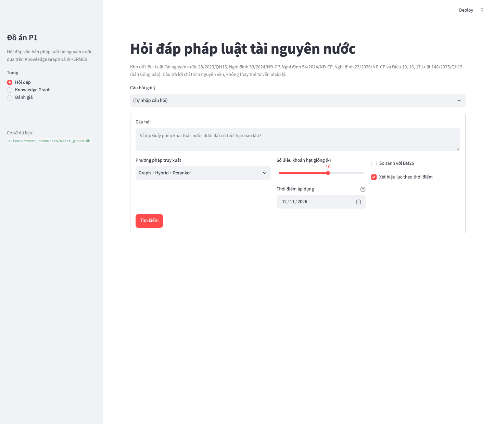
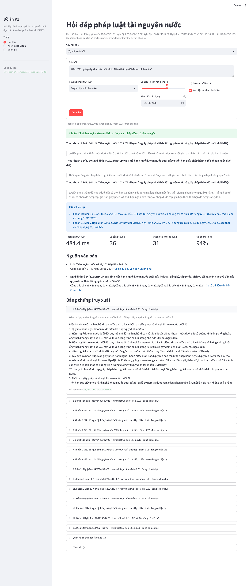
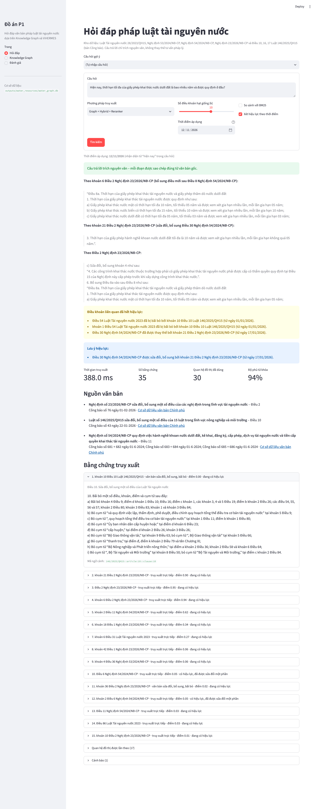
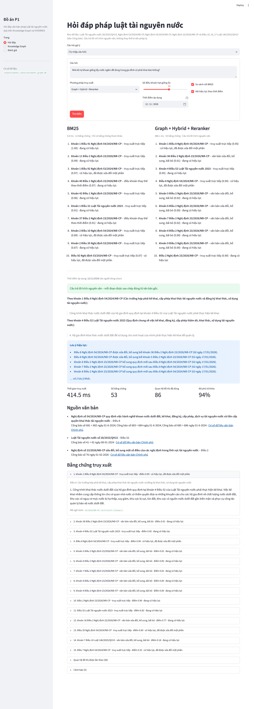
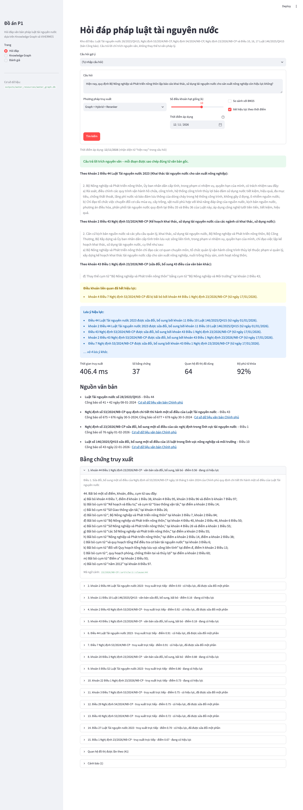
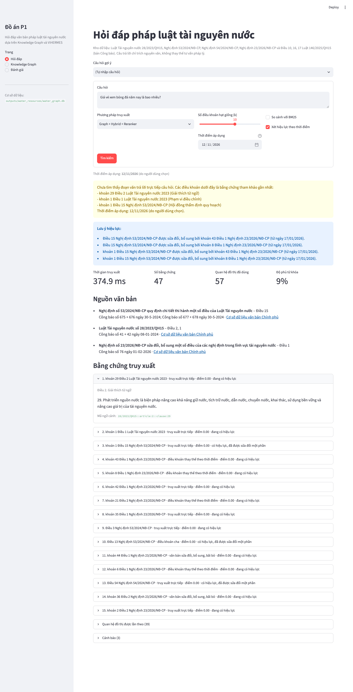
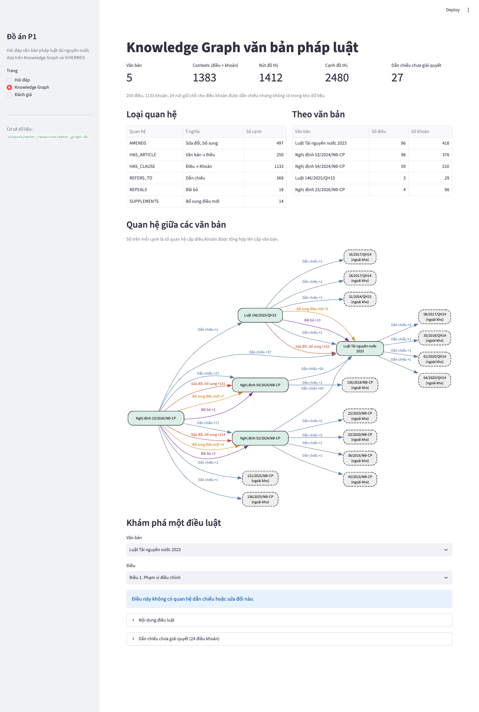
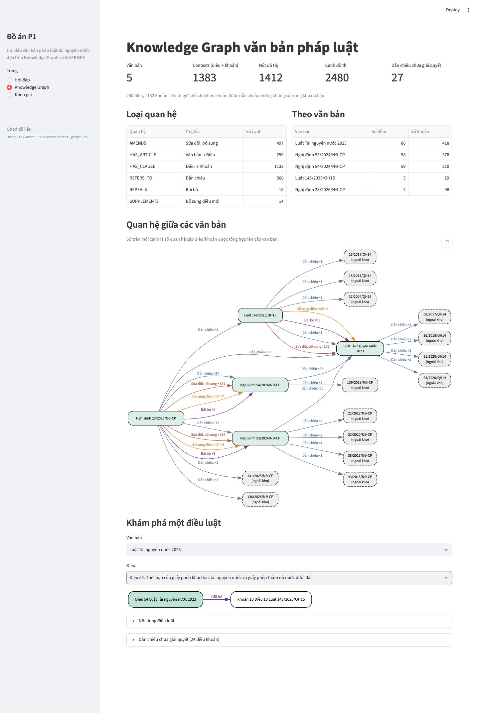
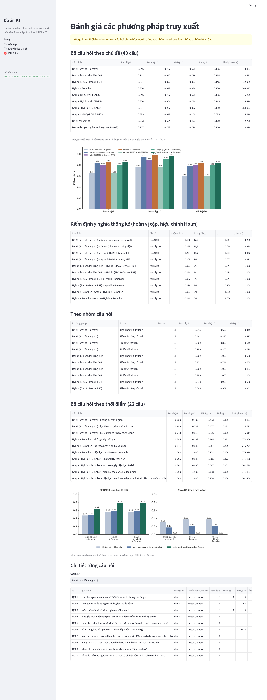

# Hướng dẫn demo P1 (phiên bản 2) – TempLaw-KAG: hỏi đáp pháp luật tài nguyên nước theo thời điểm

Thời lượng: khoảng 12–15 phút, cộng thời gian hỏi đáp. Thứ tự demo: **Hỏi đáp → Knowledge Graph → Đánh giá**.

Mọi ảnh trong tài liệu này được chụp ngày 12/11/2026 khi thao tác thật trên app (`localhost`, phương pháp mặc định **Graph + Hybrid + Reranker**, k = 10, "Xét hiệu lực theo thời điểm" bật). Mỗi bước có bốn phần: **Làm gì**, **Màn hình sẽ hiện gì**, **Chỉ vào đâu và nói gì**, **Nếu bị hỏi**. Kịch bản phiên bản 1 được lưu ở [`v1/KICH_BAN_DEMO_v1.md`](v1/KICH_BAN_DEMO_v1.md).

> Thời gian truy xuất thay đổi mỗi lần bấm. Với Reranker, thời gian thường khoảng 0,3–0,5 giây trên MacBook M4 Pro; **câu đầu tiên chậm hơn nhiều (khoảng 5 giây)** vì phải nạp ba mô hình. Đừng đọc một con số cố định, hãy nói "dưới nửa giây".

---

## 0. Chuẩn bị (trước khi giảng viên vào)

```bash
cd ViHERMES
source .venv/bin/activate
streamlit run app/streamlit_app.py
```

1. **Tắt thông báo của Streamlit** ở góc phải trên (*"Help agents write better apps"*), bấm **Don't show again**.
2. **Hỏi thử một câu để nạp mô hình** (bi-encoder, cross-encoder và Knowledge Graph), sau đó nhấn **F5** để màn hình trống trở lại. Không làm bước này thì câu đầu tiên khi demo sẽ mất khoảng 5 giây.
3. Phóng to trình duyệt lên 110–125% để người xem đọc được chữ.
4. Mở sẵn một tab dự phòng. Nếu gõ phím bị lỗi, dán link `http://localhost:8501/?q=<câu hỏi>&compare=1`, app sẽ tự trả lời câu đó.
5. Kiểm tra ô **Thời điểm áp dụng** đang là ngày hôm nay và ô **Xét hiệu lực theo thời điểm** đã được chọn.

Màn hình lúc bắt đầu:



---

## 1. Mở đầu (1 phút)

> "Văn bản pháp luật luôn bị sửa đổi. Luật Tài nguyên nước 2023 có hiệu lực từ 1/7/2024; từ 1/1/2026 Luật 146 đã sửa, thay thế và bãi bỏ nhiều điều; từ 17/1/2026 Nghị định 23 sửa hàng trăm khoản của hai nghị định hướng dẫn. Vì vậy cùng một câu hỏi có đáp án khác nhau tùy thời điểm.
> Phiên bản 2 của đề tài có hai điểm mới. Thứ nhất, Knowledge Graph biết ngày hiệu lực của từng thay đổi, nên trả lời đúng điều khoản đang có hiệu lực tại thời điểm được hỏi. Thứ hai, truy xuất dùng mô hình học máy tiếng Việt, nên hiểu được cả câu hỏi bằng từ ngữ đời thường. Em xin demo phần hỏi đáp trước, sau đó mở đồ thị để giải thích vì sao hệ thống trả lời được như vậy."

> "Ô **Phương pháp truy xuất** có 7 lựa chọn, từ BM25 đến cấu hình đầy đủ Graph + Hybrid + Reranker. Ô **Thời điểm áp dụng** là ngày áp dụng luật; nếu câu hỏi có cụm từ như 'hiện nay', 'năm 2025', hệ thống ưu tiên cụm từ đó."

---

## 2. Trang Hỏi đáp (7 phút)

### 2a. Câu hỏi có mốc "năm 2025"

**Làm gì:** gõ **"Năm 2025, giấy phép khai thác nước dưới đất có thời hạn tối đa bao nhiêu năm?"**, bấm **Tìm kiếm**.

**Màn hình sẽ hiện:**



**Chỉ vào đâu và nói gì:**
1. Dòng xám trên cùng: *"Thời điểm áp dụng: 31/12/2025 (nhận diện từ “năm 2025” trong câu hỏi)"*.
   > "Hệ thống nhận diện cụm 'năm 2025' và chuẩn hóa thành ngày cuối năm 2025."
2. Đoạn trích đầu: **khoản 1 Điều 54 Luật Tài nguyên nước 2023**, điểm c: tối đa 05 năm, tối thiểu 03 năm.
3. Khung **Lưu ý hiệu lực**: *"khoản 10 Điều 10 Luật 146/2025/QH15 thay đổi Điều 54 … nhưng chỉ có hiệu lực từ ngày 01/01/2026, sau thời điểm áp dụng 31/12/2025."*
   > "Đồ thị biết Điều 54 sẽ bị bãi bỏ, nhưng tại cuối năm 2025 việc bãi bỏ chưa có hiệu lực, nên Điều 54 vẫn là đáp án đúng."

**Nếu bị hỏi** *"Sao 'năm 2025' lại là ngày 31/12?"*: quy ước là trạng thái pháp luật ở cuối giai đoạn được hỏi (và không vượt quá hôm nay). "Đầu năm" là 01/01, "giữa năm" là 30/06.

### 2b. Cùng câu hỏi, mốc "hiện nay"

**Làm gì:** chọn câu gợi ý **"Hiện nay, thời hạn tối đa của giấy phép khai thác nước dưới đất là bao nhiêu năm và được quy định ở đâu?"**, bấm **Tìm kiếm**.

**Màn hình sẽ hiện:**



**Chỉ vào đâu và nói gì:**
1. *"Thời điểm áp dụng: 12/11/2026 (nhận diện từ “hiện nay” trong câu hỏi)"*.
2. Đoạn trích đầu: **khoản 6 Điều 2 Nghị định 23/2026** (bổ sung **Điều 8a** Nghị định 54): giấy phép khai thác nước dưới đất tối đa 05 năm.
3. Khung vàng **Điều khoản liên quan đã hết hiệu lực**: *"Điều 54 Luật Tài nguyên nước 2023 đã bị bãi bỏ bởi khoản 10 Điều 10 Luật 146/2025/QH15 (từ ngày 01/01/2026)."*
   > "Con số vẫn là 05 năm, nhưng căn cứ pháp lý đã chuyển từ Luật sang Nghị định. Đây là điều tìm kiếm theo từ khóa không làm được: BM25 vẫn trả về Điều 54 như thể còn hiệu lực."
4. Mở rộng bằng chứng số 2 hoặc 3: nhãn **"đang có hiệu lực"** cạnh từng điều khoản.

**Nếu bị hỏi** *"Đoạn trích thứ hai nói 10 năm là sao?"*: đó là giấy phép **hành nghề khoan** (Điều 30 NĐ 54 sau sửa đổi), không phải giấy phép khai thác. Hệ thống trích tối đa 3 đoạn liên quan; đoạn đầu là đáp án.

### 2c. Câu hỏi đời thường và so sánh với BM25

**Làm gì:** gõ **"Nhà tôi tự khoan giếng lấy nước ngầm để dùng trong gia đình có phải khai báo không?"**, chọn ô **So sánh với BM25**, bấm **Tìm kiếm**.

**Màn hình sẽ hiện:**



**Chỉ vào đâu và nói gì:**
1. Cột trái **BM25**: *"Chỉ có bằng chứng tham khảo"*; 10 kết quả **không có khoản 4 Điều 52 Luật**.
   > "Người dân nói 'nước ngầm', 'khai báo', còn luật viết 'nước dưới đất', 'kê khai'. BM25 chỉ khớp từ nên trượt."
2. Cột phải **Graph + Hybrid + Reranker**: *"Câu trả lời trích nguyên văn"*; **khoản 4 Điều 52 Luật Tài nguyên nước 2023** ở hạng 3.
3. Câu trả lời phía dưới: *"Hộ gia đình khai thác nước dưới đất để sử dụng cho sinh hoạt của mình phải thực hiện kê khai để quản lý."*
   > "Mô hình PhoBERT, sau bước tách từ tiếng Việt, hiểu 'nước ngầm' gần nghĩa với 'nước dưới đất'. Trên bộ đánh giá, BM25 bỏ sót 4/11 câu đời thường, còn mô hình dense tìm được cả 4."

### 2d. "… còn hiệu lực không?": vai trò của cạnh bãi bỏ

**Làm gì:** gõ **"Hiện nay, quy định Bộ Nông nghiệp và Phát triển nông thôn lập báo cáo khai thác, sử dụng tài nguyên nước cho sản xuất nông nghiệp còn hiệu lực không?"**, bỏ chọn **So sánh với BM25**, bấm **Tìm kiếm**.

**Màn hình sẽ hiện:**



**Chỉ vào đâu và nói gì:**
1. Khung vàng **Điều khoản liên quan đã hết hiệu lực**: *"khoản 4 Điều 7 Nghị định 53/2024/NĐ-CP đã bị bãi bỏ bởi khoản 44 Điều 1 Nghị định 23/2026/NĐ-CP (từ ngày 17/01/2026)."*
   > "Đây là câu trả lời thật sự cho câu hỏi: quy định đó **không còn hiệu lực**. Thông tin này lấy từ cạnh REPEALS trên đồ thị. Trên bộ đánh giá, không cấu hình nào không dùng đồ thị hiệu lực đưa được khoản bãi bỏ vào top-10."
2. Các đoạn trích phía trên là các quy định cùng chủ đề **đang có hiệu lực**.

**Nếu bị hỏi** *"Sao đoạn trích không nói thẳng 'đã bị bãi bỏ'?"*: bộ chọn đoạn trích chọn đoạn liên quan nhất về nội dung. Thông tin bãi bỏ được nêu ở khung cảnh báo, lấy trực tiếp từ đồ thị. Hạn chế: cảnh báo chỉ áp dụng cho 3 điều khoản liên quan nhất, nên với một số câu (ví dụ câu T18 về Điều 16 Luật) cảnh báo không xuất hiện.

### 2e. Câu ngoài phạm vi: hệ thống không bịa

**Làm gì:** gõ **"Giá vé xem bóng đá năm nay là bao nhiêu?"**, bấm **Tìm kiếm**.

**Màn hình sẽ hiện:**



**Chỉ vào đâu và nói gì:**
> "Hệ thống báo *'Chưa tìm thấy đoạn văn trả lời trực tiếp'* và chỉ liệt kê điều khoản tham khảo với độ phủ từ khóa 9%. Câu trả lời luôn là đoạn trích nguyên văn, nên hệ thống không bao giờ tạo ra nội dung pháp lý không có trong văn bản."

> "Các khung hiệu lực và cảnh báo bãi bỏ vừa rồi đều lấy từ Knowledge Graph. Em xin mở đồ thị để thầy/cô xem."

---

## 3. Trang Knowledge Graph (2–3 phút)

**Làm gì:** ở thanh bên trái chọn **Knowledge Graph**.



**Chỉ vào đâu và nói gì:**
1. Hàng số liệu: 5 văn bản, 1.383 điều khoản, 1.412 nút, **2.480 cạnh**.
2. Bảng **Loại quan hệ**: REFERS_TO 568, AMENDS 497, **REPEALS 18**, SUPPLEMENTS 14.
   > "REPEALS là quan hệ mới của phiên bản 2. Bộ phân tích câu lệnh mới đọc được các câu như 'Bãi bỏ … các điều 54, 55, 56 và 57'. So với phiên bản 1, em đã loại 3 cặp cạnh sai và thêm 19 cặp còn thiếu, cả 22 thay đổi đều được đối chiếu thủ công với Công báo."
3. Đồ thị **Quan hệ giữa các văn bản**: cạnh tím **"Bãi bỏ ×13"** từ Luật 146 tới Luật Tài nguyên nước 2023.

**Làm gì:** cuộn xuống **Khám phá một điều luật**, chọn văn bản **Luật Tài nguyên nước 2023**, chọn **Điều 54**.



> "Điều 54 có một cạnh **Bãi bỏ** tới khoản 10 Điều 10 Luật 146. Mỗi cạnh trong cơ sở dữ liệu còn mang ngày hiệu lực, ở đây là 01/01/2026. Nhờ đó hệ thống tính được trạng thái của Điều 54 tại bất kỳ ngày nào: còn hiệu lực năm 2025, bị bãi bỏ từ 2026."

---

## 4. Trang Đánh giá (2 phút)

**Làm gì:** ở thanh bên trái chọn **Đánh giá**.



**Chỉ vào đâu và nói gì:**
1. Dòng vàng: *"Kết quả tạm thời … Đã xác nhận 0/62 câu."*
   > "Em nói rõ: 62 câu hỏi do em soạn, chưa có người khác xác nhận, nên mọi số liệu là tạm thời."
2. Bảng **Bộ câu hỏi theo chủ đề (40 câu)**: BM25 Recall@10 0,767, MRR@10 0,599 → Hybrid + Reranker **0,979** và **0,834**.
3. Bảng **Kiểm định ý nghĩa thống kê**: BM25 → Hybrid có p (Holm) = 0,022; mở rộng láng giềng trên đồ thị không tạo khác biệt.
4. Cuộn xuống **Bộ câu hỏi theo thời điểm (22 câu)**: MRR@10 0,565 → **0,778** khi bật hiệu lực theo Knowledge Graph; Stale@5 từ 0,373 xuống 0.
   > "Kết luận chính: truy xuất thần kinh giúp câu hỏi theo chủ đề, còn Knowledge Graph phát huy giá trị qua lớp hiệu lực theo thời gian. Lọc theo ngày văn bản mà không dùng đồ thị chỉ tăng 0,022, vì nó không biết một điều đã bị văn bản khác bãi bỏ."

---

## 5. Kết (30 giây)

> "Tóm lại: hệ thống trích nguyên văn, trả lời đúng phiên bản luật tại thời điểm được hỏi, cảnh báo khi điều khoản đã bị bãi bỏ hoặc thay thế, và hiểu được câu hỏi đời thường. Hạn chế:
> - benchmark 62 câu chưa được xác nhận độc lập, và em là người soạn câu hỏi;
> - ngày hiệu lực đang ở cấp văn bản, chưa mô hình hóa ngoại lệ;
> - phần sinh câu trả lời bằng LLM đã có mã nhưng chưa được đánh giá vì không có khóa API.
> Hướng tiếp theo: ngày hiệu lực cấp điều khoản, câu hỏi thật của người dùng và đánh giá phần sinh bằng LLM."

---

## 6. Những chỗ KHÔNG nên bấm khi demo

| Câu hoặc thao tác | Vấn đề thật (đã kiểm tra ngày 12/11/2026) | Nếu giảng viên tự bấm |
|---|---|---|
| **"Hiện nay, giấy phép khai thác nước dưới đất có thời hạn tối đa bao nhiêu năm?"** (khác câu gợi ý ở cách nói) | Với cách nói này, bộ chọn đoạn trích ngữ nghĩa (cross-encoder) đặt đoạn về giấy phép **hành nghề khoan** (10 năm, khoản 21 Điều 2 NĐ 23) **trước** Điều 8a (05 năm). Truy xuất vẫn đúng; bộ chọn từ vựng chọn đúng. Lỗi đã ghi trong bài báo, mục 6.4. | "Đây là điểm yếu em đã ghi nhận: cross-encoder nhạy với cách diễn đạt và nhầm 'hành nghề khoan' với 'khai thác'. Đoạn thứ hai chính là đáp án đúng. Em không chỉnh phương pháp theo đúng ví dụ này để tránh làm sai lệch số liệu đánh giá." |
| **"Điều 33 Nghị định 53/2024 quy định gì?"** | Hệ thống chưa hiểu "Điều 33" là địa chỉ của một điều luật. Top-5 toàn là khoản của NĐ 23/2026 (có tên NĐ 53 trong tiêu đề), không có Điều 33 NĐ 53. | "Hệ thống tìm theo nội dung, chưa phân tích tham chiếu cấu trúc trong câu hỏi. Hướng mở rộng: nhận diện 'Điều X, khoản Y' rồi tra thẳng nút trên đồ thị." |
| **"Hiện nay, quy định của Luật Tài nguyên nước về nội dung chính của quy hoạch tổng hợp lưu vực sông liên tỉnh còn hiệu lực không?"** | Truy xuất đưa khoản bãi bỏ vào top-10, nhưng Điều 16 không nằm trong 3 kết quả đầu nên **không có khung cảnh báo bãi bỏ**. | "Cảnh báo chỉ áp dụng cho 3 điều khoản liên quan nhất. Khoản bãi bỏ vẫn có trong danh sách bằng chứng, kèm nhãn hiệu lực." |
| **Đổi ô Thời điểm áp dụng về trước 01/07/2024** | Kho không có Luật 17/2012, nên hệ thống chỉ cảnh báo "Thời điểm trước ngày có hiệu lực của các văn bản trong kho" và không lọc. | "Đây là giới hạn dữ liệu, em ghi trong phần hạn chế." |
| **Câu hỏi đầu tiên sau khi khởi động app** | Mất khoảng 5 giây để nạp mô hình. | Đã xử lý ở bước chuẩn bị 2. |

---

## 7. Câu hỏi giảng viên có thể hỏi

**Phiên bản 2 khác phiên bản 1 ở đâu?**
1. Bộ phân tích câu lệnh sửa đổi mới ([instructions.py](../src/vihermes/water/instructions.py)): đọc được danh sách dẫn chiếu tiếng Việt, phân loại bãi bỏ / thay thế / sửa một phần / thay cụm từ, thêm quan hệ REPEALS.
2. Knowledge Graph hiệu lực có ngày và phân giải theo thời điểm ([temporal.py](../src/vihermes/water/temporal.py)).
3. Nhận diện biểu thức thời gian trong câu hỏi (cùng tệp).
4. Truy xuất thần kinh ([dense.py](../src/vihermes/water/dense.py)): tách từ pyvi, bi-encoder bkai (PhoBERT), RRF, cross-encoder PhoRanker; bộ chọn đoạn trích ngữ nghĩa.
5. Benchmark 62 câu, 21 cấu hình, kiểm định hoán vị với hiệu chỉnh Holm ([benchmark.py](../src/vihermes/water/benchmark.py)).

**ViHERMES là gì, em dùng nó vào việc gì?**
ViHERMES là mã nguồn mở (MIT) đi kèm bài báo ACIIDS 2026 về hỏi đáp đa bước trên văn bản pháp luật y tế. Đồ án dùng lại mô hình nút/cạnh, kho đồ thị SQLite, BM25, `GraphPropagator` để lan truyền theo quan hệ, và Conductor/Auditor cho phần sinh câu trả lời tùy chọn. Thay đổi duy nhất trong mã lõi ViHERMES là thêm quan hệ `REPEALS` vào tập quan hệ hiệu lực.

**Câu hỏi được xử lý thế nào trước khi tìm?**
1. **Nhận diện thời gian**: tìm ngày cụ thể, mốc gắn với văn bản ("trước khi NĐ 23 có hiệu lực"), tháng/năm, "hiện nay"; chuẩn hóa thành một ngày áp dụng.
2. **BM25**: chuẩn hóa NFC, chữ thường, tách âm tiết, thêm bigram âm tiết.
3. **Dense**: tách từ bằng pyvi ("nước ngầm" → "nước_ngầm"), mã hóa bằng bi-encoder PhoBERT, so với 2.867 đoạn đã mã hóa sẵn.
4. **Kết hợp** hai bảng xếp hạng bằng RRF (k = 60), cộng 0,1 điểm cho văn bản được nêu tên trong câu hỏi.
5. **Mở rộng đồ thị** từ 10 hạt giống, **xếp hạng lại** bằng cross-encoder, rồi **áp hiệu lực** theo ngày áp dụng.

**Vì sao không dùng LLM để trả lời?**
Văn bản pháp luật cần chính xác. Trích nguyên văn bảo đảm mọi câu trả lời đều có trong văn bản gốc. Phần sinh bằng LLM đã có ([generate.py](../src/vihermes/water/generate.py)), dùng Auditor của ViHERMES để kiểm tra mọi trích dẫn phải khớp nguyên văn và còn hiệu lực, nhưng chưa được đánh giá vì không có khóa API.

**Graph không giúp truy xuất theo chủ đề thì có ý nghĩa gì?**
Đó là kết quả trung thực của cả hai phiên bản: mở rộng láng giềng không tăng Recall/MRR. Giá trị của đồ thị nằm ở **hiệu lực theo thời gian**: trên 22 câu có mốc thời gian, MRR@10 tăng 0,213, thắng 11 câu, không thua câu nào (p = 0,011 sau hiệu chỉnh Holm).

**Stale@5 bằng 0 có phải "tự chấm điểm cho mình" không?**
Đúng là bằng 0 theo thiết kế, vì điều khoản hết hiệu lực luôn bị chuyển xuống cuối. Vì vậy em dùng chỉ số này để đo **mức độ của vấn đề** ở các phương pháp khác (30–37% top-5 là luật hết hiệu lực), còn so sánh chính dựa trên Recall/MRR với nhãn là điều khoản có hiệu lực tại ngày hỏi.

**Nhận diện thời gian đúng 22/22, có đáng tin không?**
Chưa: câu hỏi và luật nhận diện do cùng một người viết. Con số này chỉ cho thấy bộ luật hoạt động trên các mẫu đã thiết kế, không phản ánh câu hỏi thật của người dùng.

**Benchmark lấy ở đâu, vì sao còn "tạm thời"?**
62 câu: 29 câu của phiên bản 1, 11 câu đời thường, 22 câu có mốc thời gian (11 cặp trước/sau sửa đổi và các mốc biên như 10/01/2026, khi Luật 146 đã có hiệu lực nhưng NĐ 23 chưa). Tất cả ở trạng thái `needs_review`. Đáp án câu theo thời điểm được kiểm tra tự động là đang có hiệu lực tại ngày đó.

**Có khoảng thời gian nào luật "trống" không?**
Có, trong kho dữ liệu: từ 01/01 đến 16/01/2026, Điều 54 Luật đã bị bãi bỏ nhưng Điều 8a NĐ 54 chưa có hiệu lực, nên kho không có điều khoản nào quy định thời hạn giấy phép khai thác nước dưới đất (Hình 2 bài báo). Thực tế có thể có quy định chuyển tiếp ngoài kho dữ liệu.

**Tham số k là gì?**
Số điều khoản hạt giống lấy ra đầu tiên (mặc định 10, giống khi đánh giá). Với Reranker, hệ thống lấy 30 ứng viên Hybrid, cộng láng giềng đồ thị (trung bình 37,4 ứng viên), rồi cross-encoder xếp hạng lại toàn bộ.
