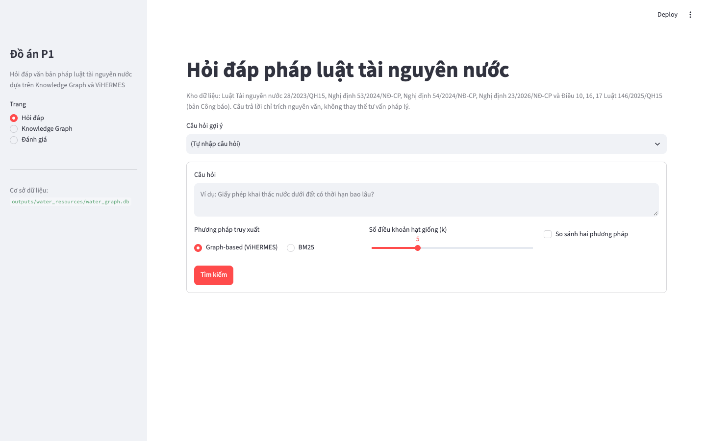
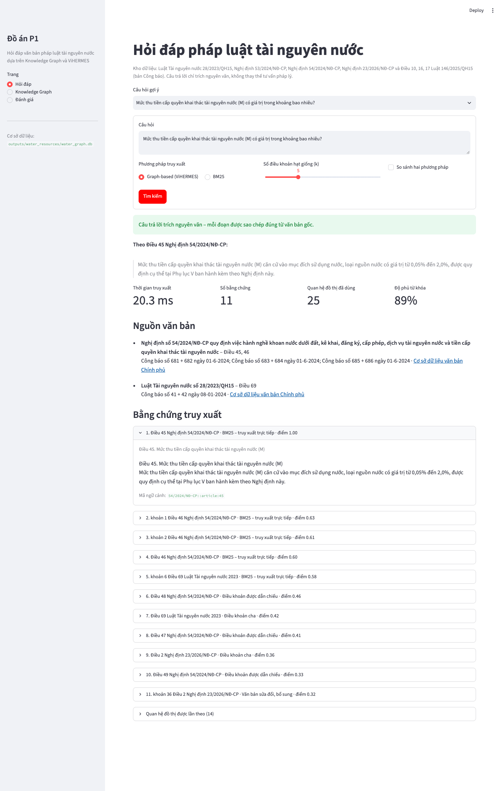
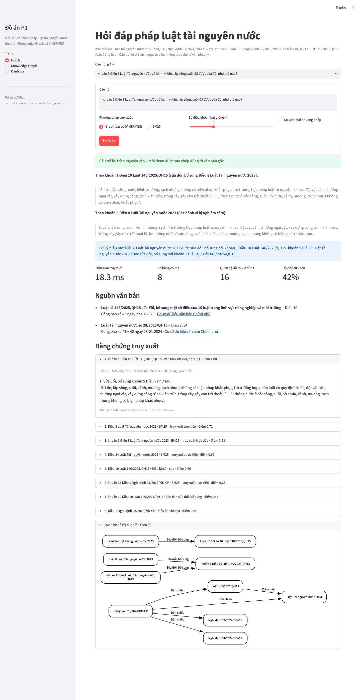
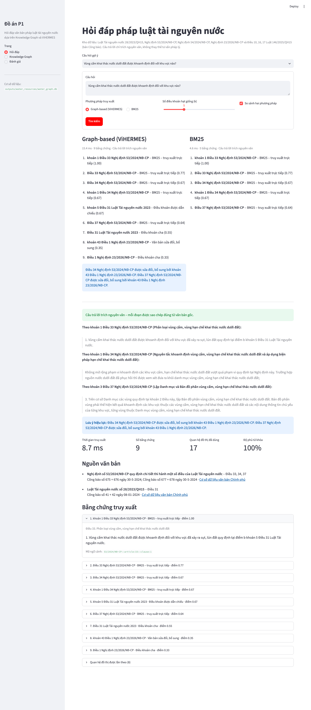
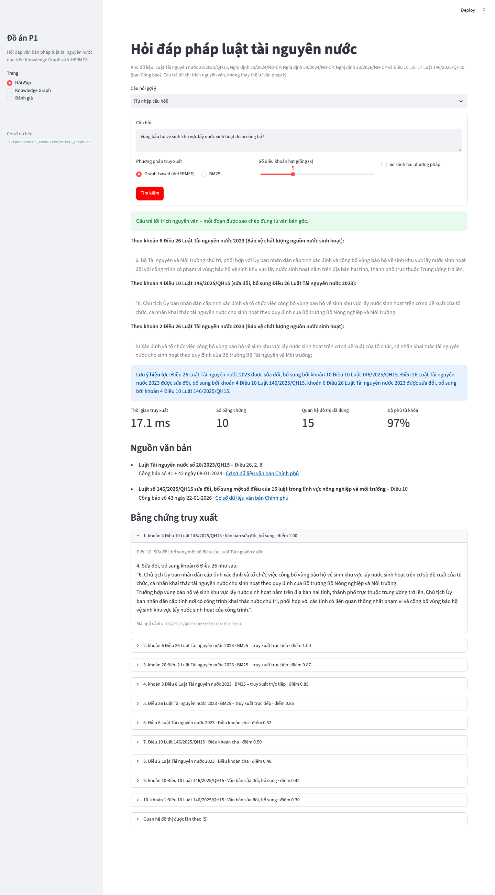
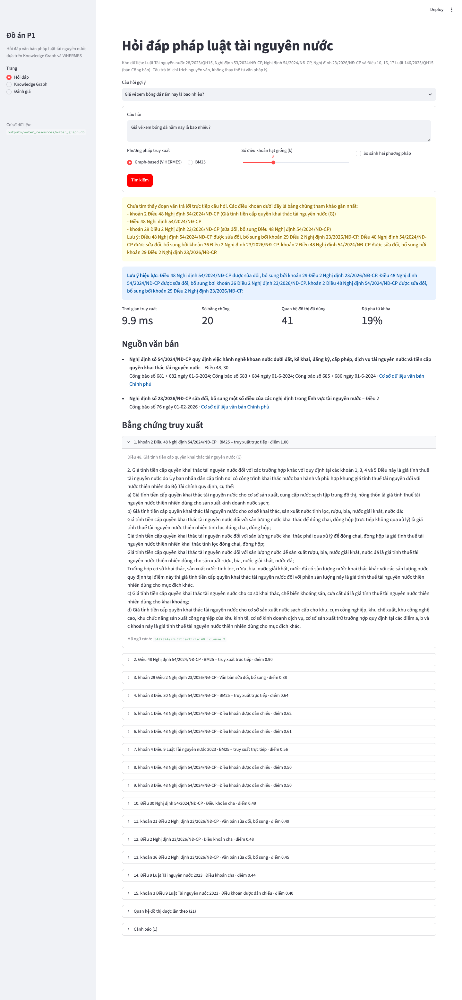
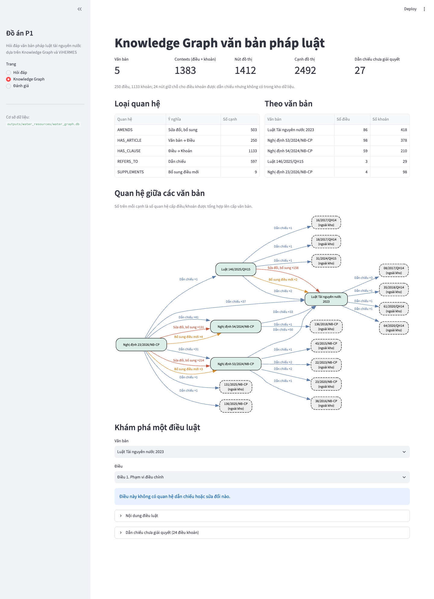
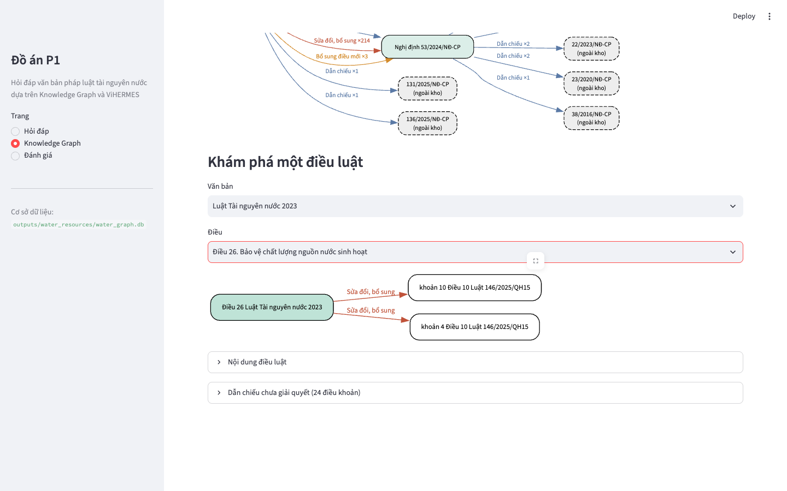
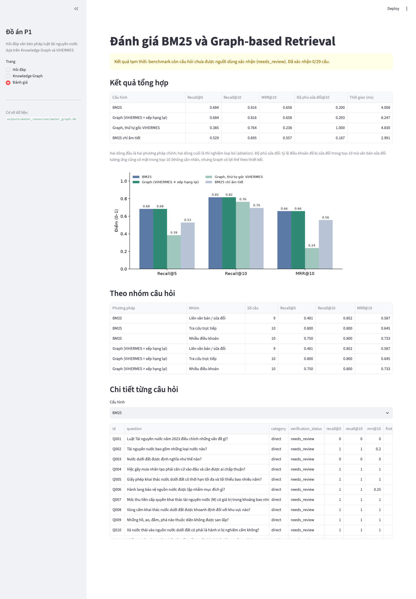

# Hướng dẫn demo P1 – Hỏi đáp pháp luật tài nguyên nước

Thời lượng: khoảng 12 phút, cộng thời gian hỏi đáp. Thứ tự demo: **Hỏi đáp → Knowledge Graph → Đánh giá**.

Mọi ảnh trong tài liệu này được chụp ngày 06/11/2026 khi thao tác thật trên app (`localhost:8501`, k = 5). Mỗi bước có bốn phần: **Làm gì**, **Màn hình sẽ hiện gì**, **Chỉ vào đâu và nói gì**, **Nếu bị hỏi**.

> Thời gian truy xuất (ms) thay đổi mỗi lần bấm, thường khoảng 8–20 ms trên giao diện. Đừng đọc một con số cố định, hãy nói "khoảng vài chục mili giây".

---

## 0. Chuẩn bị (trước khi giảng viên vào)

```bash
cd ViHERMES
source .venv/bin/activate
streamlit run app/streamlit_app.py
```

1. **Tắt thông báo của Streamlit.** Ở góc phải trên sẽ hiện hộp *"Help agents write better apps"*, che mất một phần kết quả. Bấm **Don't show again**.
2. Hỏi thử một câu để app nạp đồ thị vào bộ nhớ đệm, sau đó nhấn **F5** để màn hình trống trở lại.
3. Phóng to trình duyệt lên 110–125% để người xem đọc được chữ.
4. Mở sẵn một tab dự phòng. Nếu gõ phím bị lỗi, dán link `http://localhost:8501/?q=<câu hỏi>&compare=1`, app sẽ tự trả lời câu đó.

Màn hình lúc bắt đầu:



---

## 1. Mở đầu (1 phút)

**Nói:**
> "Văn bản pháp luật luôn bị sửa đổi. Luật Tài nguyên nước 2023 đã bị Luật 146/2025 sửa và bãi bỏ nhiều điều. Hai Nghị định 53 và 54/2024 bị Nghị định 23/2026 sửa hàng trăm khoản. Nếu chỉ tìm theo từ khóa, người dùng có thể nhận được điều khoản cũ mà không biết nó đã bị sửa.
> Đề tài của em xây dựng Knowledge Graph cho 5 văn bản này, với các quan hệ dẫn chiếu và sửa đổi. Sau đó em dùng đồ thị để mở rộng kết quả truy xuất, rồi so sánh với BM25. Em xin demo phần hỏi đáp trước, sau đó sẽ mở đồ thị để giải thích vì sao hệ thống trả lời được như vậy."

**Giới thiệu khung nhập (15 giây), chỉ lần lượt vào từng phần:**
> "Người dùng chọn câu gợi ý hoặc tự gõ câu hỏi, rồi chọn phương pháp: Graph-based hoặc BM25. Thanh k là số điều khoản hạt giống, tức số điều khoản BM25 lấy ra đầu tiên. Graph sẽ mở rộng từ các hạt giống này theo các cạnh của đồ thị. Ô 'So sánh hai phương pháp' hiện kết quả hai cách cạnh nhau."

---

## 2. Trang Hỏi đáp (6 phút)

### 2a. Câu tra cứu trực tiếp: giới thiệu cách đọc kết quả

**Làm gì:** Ở ô *Câu hỏi gợi ý*, chọn *"Mức thu tiền cấp quyền khai thác tài nguyên nước (M) có giá trị trong khoảng bao nhiêu?"*. Giữ Graph-based. Bấm **Tìm kiếm**.

**Màn hình:**



**Chỉ vào đâu và nói gì, theo thứ tự từ trên xuống:**

1. **Khung xanh lá và đoạn trích Điều 45 NĐ 54/2024 ("từ 0,05% đến 2,0%")**
   > "Câu trả lời được trích nguyên văn từ văn bản gốc. Hệ thống không dùng LLM để sinh câu trả lời, nên không bịa ra nội dung pháp luật."
2. **Bốn chỉ số** (thời gian, 11 bằng chứng, 25 quan hệ đồ thị, độ phủ 89%)
   > "Độ phủ từ khóa là tỷ lệ từ khóa có nghĩa trong câu hỏi xuất hiện trong bằng chứng. Hệ thống dùng chỉ số này để quyết định có trả lời hay không."
3. **Mục Nguồn văn bản**
   > "Mỗi nguồn ghi số Công báo và có link tới Cơ sở dữ liệu văn bản Chính phủ, nên người dùng kiểm chứng được."
4. **Danh sách Bằng chứng truy xuất.** Chỉ vào nhãn sau dấu chấm giữa của từng dòng.
   > "Từ dòng 1 đến dòng 5 là hạt giống BM25, nhãn *BM25 – truy xuất trực tiếp*. Từ dòng 6 trở đi là phần đồ thị thêm vào:
   > - Điều 47, 48, 49 có nhãn *Điều khoản được dẫn chiếu*, vì Điều 46 viết 'theo quy định tại Điều 45, 47…'.
   > - Điều 69 Luật có nhãn *Điều khoản cha* của khoản 6.
   > - Khoản 36 Điều 2 NĐ 23/2026 có nhãn *Văn bản sửa đổi, bổ sung*."

### 2b. Câu về sửa đổi: điểm mạnh chính

**Làm gì:** Chọn *"Khoản 5 Điều 8 Luật Tài nguyên nước về hành vi lấn, lấp sông, suối đã được sửa đổi như thế nào?"*. Bấm **Tìm kiếm**. Kéo xuống cuối trang và bấm mở **Quan hệ đồ thị được lần theo (8)**.

**Màn hình:**



**Chỉ vào đâu và nói gì:**

1. **Hai đoạn trích**
   > "Đoạn trên là bản mới, theo khoản 1 Điều 10 Luật 146/2025. Đoạn dưới là bản cũ, theo khoản 5 Điều 8 Luật 2023. Điểm khác là cụm '**nhưng không có biện pháp khắc phục**': lấn, lấp sông giờ chỉ bị cấm khi không có biện pháp khắc phục."
2. **Khung xanh dương *Lưu ý hiệu lực***
   > "Khung này sinh ra từ cạnh AMENDS trong đồ thị, không phải do so khớp từ khóa."
3. **Bằng chứng số 1 có nhãn *Văn bản sửa đổi, bổ sung***
   > "Điều khoản xếp hạng 1 được tìm thấy nhờ cạnh sửa đổi."
4. **Sơ đồ ở cuối trang:** chỉ vào hai mũi tên *Sửa đổi, bổ sung* đi từ "Điều 8" và "khoản 5 Điều 8" tới "khoản 1 Điều 10 Luật 146".
   > "Mũi tên đi từ điều bị sửa tới khoản sửa nó. Đây đúng là hướng tra cứu mà hệ thống cần: từ điều khoản cũ tìm ra bản mới."

**Nếu bị hỏi "mũi tên ngược à?":** Đúng là có thể đọc ngược. Trong code, cạnh hiệu lực được nối từ điều khoản *được nhắc trong câu lệnh sửa đổi* tới *khoản chứa câu lệnh đó* ([links.py:135](../src/vihermes/water/links.py#L135)). Hệ thống mở rộng từ điều khoản cũ (hạt giống), nên cạnh được đặt theo chiều đó.

### 2c. So sánh hai phương pháp: lợi ích của dẫn chiếu

**Làm gì:** Chọn *"Vùng cấm khai thác nước dưới đất được khoanh định đối với khu vực nào?"*. **Tích "So sánh hai phương pháp"**. Bấm **Tìm kiếm**.

**Màn hình:**



**Chỉ vào đâu và nói gì:**

1. **Đầu hai cột:** cột Graph-based ghi *9 bằng chứng*, cột BM25 ghi *5 bằng chứng*.
2. **Dòng 5 cột trái:** *khoản 5 Điều 31 Luật Tài nguyên nước 2023 – Điều khoản được dẫn chiếu*. Chỉ tiếp vào đoạn trích khoản 1 Điều 33 ở phía dưới.
   > "Câu trả lời viết 'khu vực đã xảy ra sụt, lún đất quy định tại **điểm b khoản 5 Điều 31 Luật Tài nguyên nước**'. BM25 dừng ở đó, người đọc phải tự đi tìm Điều 31. Graph lần theo cạnh dẫn chiếu và lấy luôn khoản 5 Điều 31 của Luật."
3. **Khung xanh dương ở cột trái:**
   > "Graph còn phát hiện Điều 34 và Điều 37 NĐ 53 đã bị khoản 43 Điều 1 NĐ 23/2026 sửa. Cột BM25 không có thông tin này."
4. **So năm hạt giống hai cột:**
   > "Năm hạt giống BM25 đều có mặt ở cột Graph. Graph giữ kết quả BM25 rồi bổ sung thêm, không làm mất kết quả nào."

### 2d. Tự gõ câu hỏi trực tiếp

**Làm gì:** **Bỏ tích** so sánh. Ở *Câu hỏi gợi ý* chọn *(Tự nhập câu hỏi)*. Gõ vào ô *Câu hỏi*:

> **Vùng bảo hộ vệ sinh khu vực lấy nước sinh hoạt do ai công bố?**

Bấm **Tìm kiếm**.

**Màn hình:**



**Chỉ vào đâu và nói gì:**

1. **Hai đoạn trích đầu**
   > "Đây là câu em không đưa vào danh sách gợi ý. Đoạn thứ nhất là Luật 2023: '**Bộ Tài nguyên và Môi trường** chủ trì… công bố'. Đoạn thứ hai là bản sửa theo Luật 146/2025: '**Chủ tịch Ủy ban nhân dân cấp tỉnh** xác định và tổ chức việc công bố'. Nếu chỉ đọc Luật 2023 thì sẽ trả lời sai."
2. **Bằng chứng số 1:** khoản 4 Điều 10 Luật 146 có nhãn *Văn bản sửa đổi, bổ sung* và điểm 1,00.
3. **Đoạn trích thứ ba** (điểm b khoản 2 Điều 26, nhắc "Bộ Tài nguyên và Môi trường"). **Nên tự nói trước**, đừng đợi giảng viên hỏi:
   > "Đoạn thứ ba đã bị **bãi bỏ** bởi khoản 10 Điều 10 Luật 146. Khung lưu ý có ghi Điều 26 bị khoản 10 tác động, nhưng hệ thống đang gộp chung nhãn 'sửa đổi, bổ sung', chưa phân biệt sửa đổi với bãi bỏ. Đây là một hạn chế em ghi nhận."
4. **Câu nối:**
   > "Lát nữa em sẽ mở chính Điều 26 này trên đồ thị."

### 2e. Câu ngoài phạm vi: hệ thống không bịa

**Làm gì:** Chọn *"Giá vé xem bóng đá năm nay là bao nhiêu?"*. Bấm **Tìm kiếm**.

**Màn hình:**



**Chỉ vào đâu và nói gì:**

1. **Khung vàng** "Chưa tìm thấy đoạn văn trả lời trực tiếp câu hỏi…" và **độ phủ 19%**
   > "Khi độ phủ từ khóa thấp, hệ thống không trả lời, chỉ liệt kê bằng chứng tham khảo. Điều khoản gần nhất là 'Giá tính tiền cấp quyền', chỉ vì trùng chữ 'giá'. Với pháp luật, nói 'không tìm thấy' an toàn hơn trả lời sai."
2. **Mục *Cảnh báo (1)* ở cuối trang:** nội dung là *Bằng chứng chưa bao phủ đủ từ khóa của câu hỏi*.

**Câu chuyển trang:**
> "Các khung lưu ý hiệu lực và các điều khoản dẫn chiếu vừa rồi đều lấy từ Knowledge Graph. Em xin mở đồ thị để thầy/cô xem."

---

## 3. Trang Knowledge Graph (2–3 phút)

**Làm gì:** Ở sidebar, chọn **Knowledge Graph**.

**Màn hình:**



**Chỉ vào đâu và nói gì:**

1. **Năm con số trên cùng:** 5 văn bản · 1.383 contexts · 1.412 nút · 2.492 cạnh · 27 dẫn chiếu chưa giải quyết.
   > "Mỗi điều và mỗi khoản là một nút: 250 điều và 1.133 khoản. Ngoài ra có 24 nút giữ chỗ cho điều khoản được nhắc tới nhưng không có trong kho."
2. **Bảng *Loại quan hệ***
   > - "HAS_ARTICLE và HAS_CLAUSE là cấu trúc văn bản. Đây là nguồn của nhãn *Điều khoản cha* lúc nãy.
   > - REFERS_TO là dẫn chiếu, có 597 cạnh. Chính cạnh này kéo khoản 5 Điều 31 vào câu hỏi về vùng cấm.
   > - AMENDS (503) và SUPPLEMENTS (9) là sửa đổi và bổ sung, được trích bằng quy tắc từ câu lệnh như 'Sửa đổi, bổ sung khoản 5 Điều 8 như sau'. Chúng sinh ra các khung Lưu ý hiệu lực."
3. **Sơ đồ *Quan hệ giữa các văn bản*:** chỉ các mũi tên đỏ.
   > "NĐ 23/2026 có 214 quan hệ sửa đổi tới NĐ 53 và 131 tới NĐ 54. Luật 146/2025 có 158 quan hệ sửa đổi tới Luật 2023. Các ô viền đứt là văn bản ngoài kho, chỉ được dẫn chiếu tới."

**Làm gì tiếp:** Kéo xuống *Khám phá một điều luật*. Văn bản để nguyên *Luật Tài nguyên nước 2023*. Ở ô **Điều**, bấm vào rồi **gõ "26"** để lọc (danh sách có 86 điều, cuộn tìm sẽ lâu). Chọn *Điều 26. Bảo vệ chất lượng nguồn nước sinh hoạt*.

**Màn hình:**



**Nói:**
> "Đây là Điều 26 trong câu hỏi về vùng bảo hộ vệ sinh em vừa gõ. Có hai cạnh sửa đổi. Cạnh tới khoản 4 Điều 10 Luật 146 là cạnh sửa khoản 6, tức đổi thẩm quyền sang Chủ tịch UBND tỉnh. Cạnh tới khoản 10 Điều 10 là khoản bãi bỏ điểm b khoản 2. Nhờ hai cạnh này, hệ thống biết phải trích thêm bản mới và hiện lưu ý hiệu lực."

**Nếu bị hỏi "sao chỗ ghi 27, chỗ ghi 24 dẫn chiếu chưa giải quyết?":** Có 27 lượt dẫn chiếu trỏ tới 24 điều khoản khác nhau, vì một điều khoản có thể được nhắc nhiều lần.

---

## 4. Trang Đánh giá (2 phút)

**Làm gì:** Ở sidebar, chọn **Đánh giá**.

**Màn hình:**



**Chỉ vào đâu và nói gì:**

1. **Khung vàng "Đã xác nhận 0/29 câu".** Tự nói trước:
   > "Benchmark có 29 câu, nhãn đúng do em tạo và chưa được kiểm tra thủ công từng câu, nên kết quả đang để ở trạng thái tạm thời."
2. **Bảng *Kết quả tổng hợp*:** Graph và BM25 bằng nhau ở Recall@5 0,684, Recall@10 0,816, MRR@10 0,658.
   > "Recall và MRR của Graph bằng đúng BM25. Lý do là bước xếp hạng lại giữ hạt giống BM25 ở đầu danh sách, còn điều khoản do đồ thị thêm vào nằm phía sau. Graph hơn ở **độ phủ sửa đổi**: 0,293 so với 0,200. Nghĩa là khi top-10 có điều khoản đã bị sửa, Graph thường kéo được cả văn bản sửa đổi vào. Đổi lại, thời gian truy xuất tăng từ khoảng 4 lên khoảng 8 ms."
3. **Hai dòng cuối (ablation) và biểu đồ**
   > "Nếu dùng thứ tự gốc của ViHERMES, tức đưa mọi văn bản sửa đổi lên đầu, thì MRR giảm còn 0,238. Vậy bước xếp hạng lại là cần thiết. Nếu chỉ dùng âm tiết, bỏ cặp âm tiết liền kề (bigram), thì Recall@10 giảm từ 0,816 xuống 0,695. Vậy bigram giúp BM25 nhận lại được từ ghép như 'nước dưới đất', 'khai thác' mà không cần bộ tách từ."
4. **Bảng *Theo nhóm câu hỏi***
   > "Nhóm liên văn bản/sửa đổi có Recall@5 thấp nhất (0,481). Đây là nhóm khó nhất và cũng là nơi cần cải thiện bước xếp hạng."

---

## 5. Kết (30 giây)

> "Tóm lại: hệ thống trích nguyên văn, có cảnh báo hiệu lực và lần theo được dẫn chiếu. Hạn chế:
> - benchmark mới có 29 câu, chưa được xác nhận thủ công;
> - bộ trích quan hệ dựa trên quy tắc nên còn sót hoặc sai một số mẫu câu của Công báo, và chưa phân biệt sửa đổi với bãi bỏ;
> - Graph chưa cải thiện Recall so với BM25.
> Hướng tiếp theo: bổ sung quy tắc cho câu bãi bỏ, học cách xếp hạng lại, và thêm truy xuất ngữ nghĩa (dense retrieval)."

---

## 6. Những chỗ KHÔNG nên bấm khi demo

| Câu | Vấn đề thật (đã kiểm tra) | Nếu giảng viên tự bấm |
|---|---|---|
| **"Giấy phép khai thác nước dưới đất có thời hạn tối đa bao nhiêu năm?"** (câu gợi ý số 1) | (1) Trích 1 lấy từ Điều 54 Luật 2023, nhưng **Điều 54 đã bị bãi bỏ** bởi điểm a khoản 10 Điều 10 Luật 146/2025 ("Bãi bỏ … các điều 54, 55, 56 và 57"). Bộ trích không nhận ra mẫu câu "các điều X, Y và Z" nên đồ thị không có cạnh bãi bỏ, và app không cảnh báo. Quy định hiện hành là Điều 8a NĐ 54 (do khoản 6 Điều 2 NĐ 23/2026 bổ sung), nội dung vẫn là tối đa 05 năm. (2) Trích 2 lấy đúng Điều 8a nhưng chọn nhầm điểm a (nước mặt, 10 năm). | "Con số 05 năm đúng, nhưng căn cứ hiện hành là Điều 8a NĐ 54, vì Điều 54 Luật đã bị bãi bỏ. Bộ trích quan hệ chưa bắt được mẫu câu bãi bỏ liệt kê nhiều điều. Đây là lỗi em đã ghi nhận." |
| **Đừng tự gõ câu dạng "Điều 33 Nghị định 53/2024 quy định gì?"** | Hệ thống không hiểu "Điều 33" là địa chỉ của một điều luật, chỉ coi "điều" và "33" là từ khóa. Chạy thử câu này: 5 hạt giống không có Điều 33 NĐ 53, hạng 1 là khoản 3 Điều 96 NĐ 53. Riêng "53/2024" thì được nhận ra và cộng điểm cho NĐ 53. | "Hệ thống tìm theo nội dung, chưa phân tích được tham chiếu cấu trúc trong câu hỏi. Đây là hướng mở rộng: nhận diện 'Điều X, khoản Y' trong câu hỏi rồi tra thẳng nút tương ứng trên đồ thị." |
| "Điều kiện cấp giấy phép hành nghề khoan…" và "Thời hạn giấy phép hành nghề khoan…" | Khung lưu ý ghi "Điều 30 NĐ 54 được sửa đổi bởi **khoản 23** Điều 2 NĐ 23/2026". Thông tin này **sai**: khoản 23 thực ra sửa Điều 33. Dòng về khoản 21 thì đúng. | "Công báo đóng ngoặc kép ngay sau tên điều '“Điều 33. …”', nên bộ phân tích hiểu nhầm phần nội dung là câu lệnh sửa đổi. Có 2 cạnh AMENDS sai do lỗi này. Em đã kiểm tra thủ công 160 cạnh dạng câu lệnh cấu trúc, các cạnh còn lại đúng." |

---

## 7. Câu hỏi giảng viên có thể hỏi

**ViHERMES là gì, em dùng nó vào việc gì?**
ViHERMES là mã nguồn mở (MIT) đi kèm bài báo ACIIDS 2026 của nhóm URA, ĐH Bách khoa TP.HCM. Bài báo làm hỏi đáp đa bước trên văn bản pháp luật **y tế**: dựng đồ thị điều–khoản (SRKG), rồi trả lời bằng 4 tác tử Interpreter, Pathfinder, Auditor, Conductor. Đồ án chuyển phương pháp đó sang **tài nguyên nước**.
- *Dùng lại:* mô hình nút/cạnh và mã định danh `văn bản::article:X::clause:Y`; kho đồ thị SQLite; công thức BM25 và cách chuẩn hóa điểm; `HybridRetriever` để gieo hạt; `GraphPropagator` để lan truyền (theo AMENDS/SUPPLEMENTS đệ quy tối đa 4 bước, REFERS_TO 1 bước, lên điều cha); `Pathfinder` để ghép hai bước này.
- *Không dùng:* dense retrieval, LLM, các tác tử Interpreter/Auditor/Conductor, bộ dữ liệu y tế 1.561 câu.
- *Em tự làm:* trích văn bản từ PDF Công báo, tách điều/khoản, trích quan hệ sửa đổi và dẫn chiếu bằng quy tắc, BM25 có bigram, xếp hạng lại, trả lời trích nguyên văn có ngưỡng độ phủ, benchmark 29 câu, giao diện Streamlit.

**Câu hỏi được xử lý thế nào trước khi tìm?**
Hệ thống xử lý nhẹ, không dùng LLM, không phân loại ý định, không mở rộng từ đồng nghĩa:
1. **Chuẩn hóa:** đưa Unicode về dạng NFC (tránh lỗi dấu tiếng Việt khi gõ từ các bộ gõ khác nhau) và chuyển về chữ thường ([retrieval.py:17](../src/vihermes/retrieval.py#L17)).
2. **Tách âm tiết:** lấy các chuỗi chữ và số, bỏ dấu câu. Ví dụ "Vùng bảo hộ vệ sinh…" thành `vùng, bảo, hộ, vệ, sinh, …`.
3. **Thêm bigram âm tiết:** ghép từng cặp âm tiết liền nhau, như `bảo_hộ`, `vệ_sinh`, `công_bố`, để giữ nghĩa của từ ghép ([lexical.py:15](../src/vihermes/water/lexical.py#L15)). Bigram không có trong kho (như `do_ai`) có IDF bằng 0, tự động không ảnh hưởng.
4. **Nhận diện tên văn bản:** số hiệu đầy đủ "53/2024/NĐ-CP", số rút gọn "53/2024", hoặc tên gọi "Luật Tài nguyên nước". Văn bản được nhắc tới được **cộng 0,1 điểm**, chỉ là gợi ý xếp hạng, không lọc bỏ văn bản khác ([qa.py:136](../src/vihermes/water/qa.py#L136), [retrieval.py:130](../src/vihermes/retrieval.py#L130)).
5. **Chấm BM25** trên 1.383 điều và khoản, chuẩn hóa điểm về khoảng 0–1, lấy k hạt giống.

Từ để hỏi ("ai, gì, nào, bao nhiêu, như thế nào…") **không bị loại khi chấm BM25**, vì IDF đã tự giảm trọng số cho từ phổ biến. Danh sách từ để hỏi chỉ dùng ở bước sau: tính độ phủ và chọn câu trích.

**Graph không hơn BM25 về Recall thì dùng đồ thị để làm gì?**
Graph cho thông tin về hiệu lực (độ phủ sửa đổi 0,293 so với 0,200) và lần theo dẫn chiếu (mục 2c). Ở 2 câu liên văn bản (Q021, Q022), Graph có tìm tới điều khoản đích, nhưng bước xếp hạng lại đẩy chúng xuống hạng 11 và 21, nên chúng nằm ngoài top-10. Đây là điểm cần cải thiện ở bước xếp hạng lại, không phải ở bước mở rộng đồ thị.

**Vì sao không dùng LLM?**
Văn bản pháp luật cần chính xác. Trích nguyên văn bảo đảm mọi câu trả lời đều có trong văn bản gốc và kiểm chứng được qua mã ngữ cảnh. ViHERMES vẫn có sẵn adapter cho LLM, có thể bật sau.

**Benchmark lấy ở đâu, vì sao còn "tạm thời"?**
Có 29 câu, chia 3 nhóm: tra cứu trực tiếp 10, nhiều điều khoản 10, liên văn bản/sửa đổi 9. Nhãn đang ở trạng thái `needs_review`. Khi rà soát cần lưu ý: **Q005** có nhãn đúng là Điều 54 Luật 2023, điều đã bị bãi bỏ (xem mục 6).

**Quan hệ AMENDS được trích như thế nào?**
Bằng quy tắc trên câu lệnh của Công báo: "Sửa đổi, bổ sung khoản X Điều Y như sau", "Bổ sung Điều 8a vào sau Điều 8", "Bãi bỏ…", "Bỏ cụm từ…". Có 160 cạnh dạng câu lệnh cấu trúc đã được kiểm tra và phát hiện 2 cạnh sai. Còn khoảng 352 cạnh dạng thay cụm từ hoặc bãi bỏ chưa được kiểm tra hết, và đã biết có sót mẫu "các điều 54, 55, 56 và 57".

**"Dẫn chiếu chưa giải quyết" (27) là gì?**
Là dẫn chiếu tới điều khoản không có trong kho. Có thể là văn bản khác (Luật Quy hoạch, Luật Khí tượng thủy văn…), điều mới được bổ sung như Điều 8a, 8b…, hoặc điều không được trích (Luật 146 chỉ lấy Điều 10, 16, 17). Có 27 lượt dẫn chiếu trỏ tới 24 điều khoản khác nhau, mỗi điều khoản có một nút giữ chỗ.

**Tham số k là gì? Vì sao demo để 5 mà đánh giá dùng 10?**
k là số điều khoản hạt giống BM25 lấy ra đầu tiên. Với BM25, kết quả chính là k điều khoản này. Với Graph, hệ thống mở rộng từ các hạt giống theo cạnh sửa đổi, dẫn chiếu và quan hệ cha–con, đi sâu tối đa 4 bước và lấy thêm tối đa 30 nút. Mỗi điều khoản lấy thêm được chấm lại bằng trung bình hai phần: điểm BM25 của chính nó và điểm truyền từ hạt giống. Khi đánh giá dùng k = 10 để đủ 10 kết quả tính Recall@10 và MRR@10. Khi demo để k = 5 cho màn hình gọn.

**Độ phủ từ khóa tính thế nào?**
Là tỷ lệ, tính theo trọng số IDF, các từ có nghĩa trong câu hỏi xuất hiện trong các đoạn được chọn để trích. Các từ để hỏi như "ai, gì, nào, bao nhiêu" bị loại trước khi tính. Nếu độ phủ dưới **35%** (`MIN_COVERAGE` trong [qa.py:43](../src/vihermes/water/qa.py#L43)), hệ thống không trả lời mà chỉ đưa bằng chứng tham khảo (mục 2e: 19% < 35%).
